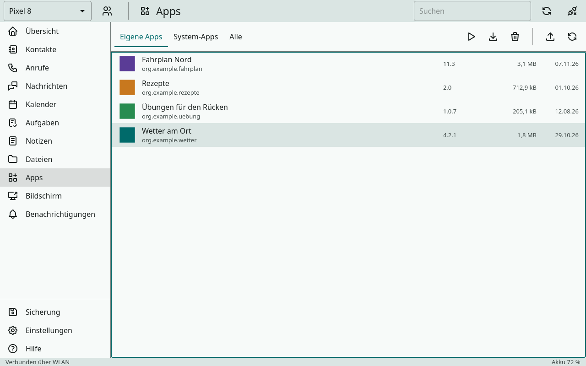

# Apps

Hier sehen Sie die Apps des Handys, sichern sie und installieren neue.

QPhoneManager fragt die Apps beim Öffnen des Bereichs vom Handy ab. Sie gehören nicht zum Abgleich. Ohne Verbindung zeigt der Bereich keine Apps.

## Das sehen Sie

Jede Zeile zeigt das Symbol der App, ihren Namen und ihr Paket, die Version, die Größe und das Installationsdatum. Die Reiter **Eigene Apps**, **System-Apps** und **Alle** filtern die Liste. Das Suchfeld in der Kopfzeile sucht in Namen und Paketen.

Rechts neben den Reitern stehen fünf Symbole:

| Symbol | Name | Wirkung |
|---|---|---|
| Dreieck | **Auf dem Handy öffnen** | Startet die gewählte App auf dem Handy |
| Pfeil nach unten | **APK auf diesem Rechner speichern** | Kopiert die Installationsdatei der App auf den Rechner |
| Papierkorb | **Vom Handy entfernen** | Entfernt die App |
| Pfeil nach oben | **APK von diesem Rechner installieren** | Installiert eine App aus einer APK-Datei |
| Zwei Pfeile im Kreis | **Apps neu laden** | Liest die Liste noch einmal |

Dieselben Aktionen bietet das Menü, das ein Rechtsklick oder die Menütaste öffnet.

## App öffnen

Wählen Sie die App und dann **Auf dem Handy öffnen**, oder drücken Sie Eingabe. Die App startet auf dem Handy. Hat sie kein eigenes Fenster, meldet QPhoneManager, dass das Handy sie nicht öffnen kann.

## APK sichern

1. Wählen Sie die App.
2. Wählen Sie **APK auf diesem Rechner speichern**.
3. Wählen Sie im Dateidialog Ort und Namen.

Eine Leiste unter der Liste zeigt den Fortschritt und lässt Sie mit **Abbrechen** stoppen. Das Sichern geht nur über WLAN oder USB.

## App installieren

1. Wählen Sie **APK von diesem Rechner installieren**.
2. Wählen Sie im Dateidialog eine APK-Datei (.apk).
3. Bestätigen Sie die Frage auf dem Handy.

QPhoneManager sendet die Datei an das Handy. Die Installation startet erst, wenn Sie auf dem Handy zustimmen. Auch das Installieren geht nur über WLAN oder USB. Eine leere oder unlesbare Datei weist QPhoneManager ab.

## App entfernen

1. Wählen Sie die App und dann **Vom Handy entfernen**, oder drücken Sie Entf.
2. Bestätigen Sie die Frage **Name entfernen?** mit **Entfernen**.
3. Bestätigen Sie die Frage auf dem Handy.

Danach löscht das Handy die App und ihre Daten. Ohne Ihre Zustimmung auf dem Handy bleibt die App.
