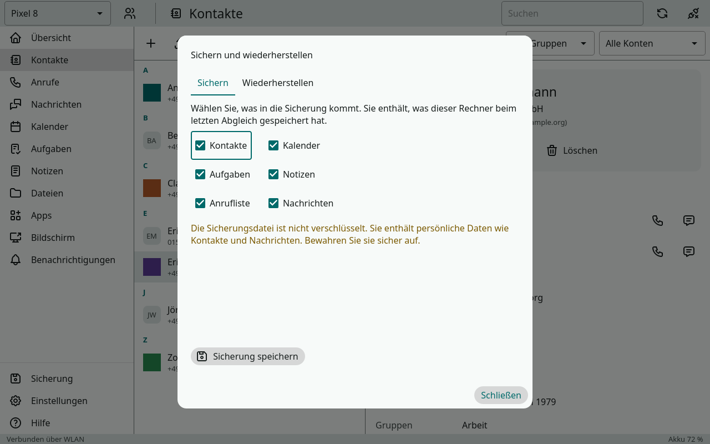
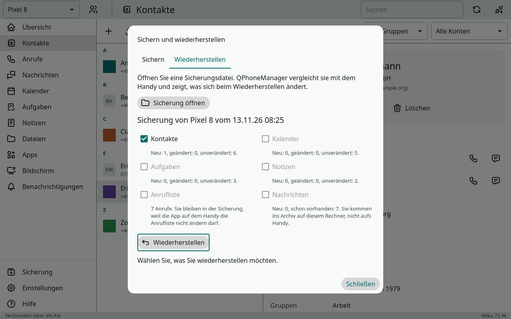

# Sichern und wiederherstellen

Eine Sicherung speichert Kontakte, Kalender, Aufgaben, Notizen, Anrufliste und Nachrichten in einer Datei. Aus dieser Datei holen Sie die Daten später zurück.

Den Dialog öffnen Sie mit **Sicherung** in der Seitenleiste. Er hat die Reiter **Sichern** und **Wiederherstellen**.

## Sichern

Die Sicherung enthält, was QPhoneManager beim letzten Abgleich gespeichert hat. Gleichen Sie das Handy deshalb vorher ab. Verbunden sein muss es zum Sichern nicht. Gewählt sein muss ein Handy.

1. Wählen Sie **Sicherung** in der Seitenleiste.
2. Setzen Sie im Reiter **Sichern** Häkchen bei den Teilen, die in die Sicherung sollen: **Kontakte**, **Kalender**, **Aufgaben**, **Notizen**, **Anrufliste** und **Nachrichten**. Ab Werk sind alle gewählt.
3. Wählen Sie **Sicherung speichern**.
4. Wählen Sie im Dateidialog Ort und Namen. QPhoneManager schlägt einen Namen mit Handy und Datum vor.

Die Datei hat die Endung .qpmbackup. Es ist ein ZIP-Archiv. Es enthält Kontakte als vCard, Termine und Aufgaben als iCalendar, Notizen als vNote, die Anrufliste als CSV-Tabelle und die Nachrichten als XML. Ein Zip-Programm öffnet sie, und Sie können Ihre Daten auch ohne QPhoneManager lesen.

Die Sicherungsdatei ist nicht verschlüsselt. Sie enthält persönliche Daten wie Kontakte und Nachrichten. Bewahren Sie sie sicher auf.

Während QPhoneManager speichert, zeigt der Dialog den Fortschritt. **Abbrechen** stoppt das Speichern. Dann bleibt keine Sicherung zurück.

## Wiederherstellen

1. Wählen Sie **Sicherung** in der Seitenleiste und den Reiter **Wiederherstellen**.
2. Wählen Sie **Sicherung öffnen** und im Dateidialog eine Datei mit der Endung .qpmbackup.
3. Lesen Sie die Vorschau. Sie nennt je Teil, was sich ändern würde.
4. Setzen Sie Häkchen bei den Teilen, die Sie zurückholen wollen.
5. Wählen Sie **Wiederherstellen**.

Kontakte, Kalender, Aufgaben und Notizen gehen zurück auf das Handy. Verbinden Sie das Handy deshalb vor Schritt 5 und lassen Sie es verbunden, bis die Meldung **Die Wiederherstellung ist fertig.** erscheint. Nur die Nachrichten lassen sich auch ohne Verbindung zurückholen.

### Die Vorschau lesen

Zu jedem Teil steht, was die Sicherung gegenüber dem Handy enthält:

- **Neu:** Der Eintrag fehlt auf dem Handy. QPhoneManager legt ihn dort an.
- **Geändert:** Es gibt den Eintrag auf dem Handy, aber mit anderem Inhalt. Die Wiederherstellung überschreibt den Eintrag auf dem Handy mit dem aus der Sicherung.
- **Unverändert:** Das Handy hat den Eintrag schon mit demselben Inhalt. Eine zweite Wiederherstellung legt darum nichts doppelt an.

Ein Teil lässt sich nur wählen, wenn er neue oder geänderte Einträge enthält. Ist das Handy nicht verbunden, vergleicht QPhoneManager die Sicherung mit den Daten auf diesem Rechner und sagt das. Kontakte, Kalender, Aufgaben und Notizen sind dann nicht wählbar. Verbinden Sie das Handy, um sie wiederherzustellen.

Für zwei Teile gilt etwas anderes:

- **Nachrichten:** Sie kommen nur in das Archiv auf diesem Rechner, nicht auf das Handy. Die App auf dem Handy nimmt keine Nachrichten an. Die Vorschau nennt, wie viele neu und wie viele schon da sind.
- **Anrufliste:** Sie bleibt in der Sicherung. Sie lässt sich nicht wiederherstellen, weil die App auf dem Handy die Anrufliste nicht ändern darf.

### Sicherung von einem anderen Handy

Stammt die Sicherung von einem anderen Handy, sagt die Vorschau das. Dann fügt die Wiederherstellung nur hinzu, was dem Handy fehlt. Vorhandene Einträge bleiben unverändert, auch wenn sie sich in der Sicherung unterscheiden.

### Was bei einzelnen Teilen gilt

- **Kontakte:** Neue Kontakte in einem Konto, das das Handy nicht hat, landen im Standardkonto des Handys. Bei neuen Kontakten entfällt ein Foto über 200 KB. Bei geänderten Kontakten bleibt das Foto des Handys.
- **Kalender:** Termine aus einem Kalender, der auf dem Handy schreibgeschützt ist, werden nicht wiederhergestellt. Die Vorschau zeigt, wie viele das sind. Termine ohne Kalender oder aus einem Kalender, den das Handy nicht hat, gehen in den Standardkalender, in den das Handy schreiben darf.

### Abbrechen und Ergebnis

Mit **Abbrechen** beenden Sie die Wiederherstellung. Was bis dahin zurückgeschrieben war, bleibt erhalten.

Danach nennt der Dialog je Teil, wie viele Einträge zurückgekommen sind und wie viele nicht. Bei Fehlern nennt die Liste den Grund. Bei vielen Einträgen dauert die Wiederherstellung länger.

## Wenn es nicht klappt

- **Die Datei ist keine QPhoneManager-Sicherung oder beschädigt:** Wählen Sie eine andere Datei.
- **Die Sicherung stammt von einer neueren Version:** Aktualisieren Sie QPhoneManager und öffnen Sie die Datei noch einmal.
- **Die Sicherung ist für eine Datei zu groß:** Wählen Sie beim Sichern weniger Teile.
- **Das Handy hat einen Eintrag nicht angenommen:** Prüfen Sie ihn auf dem Handy.
