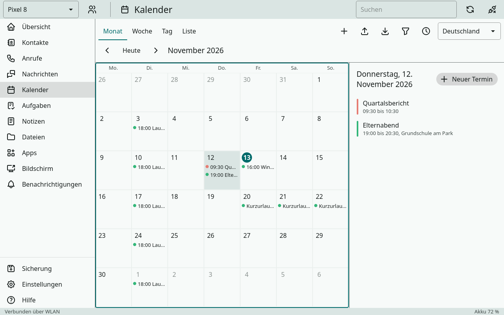
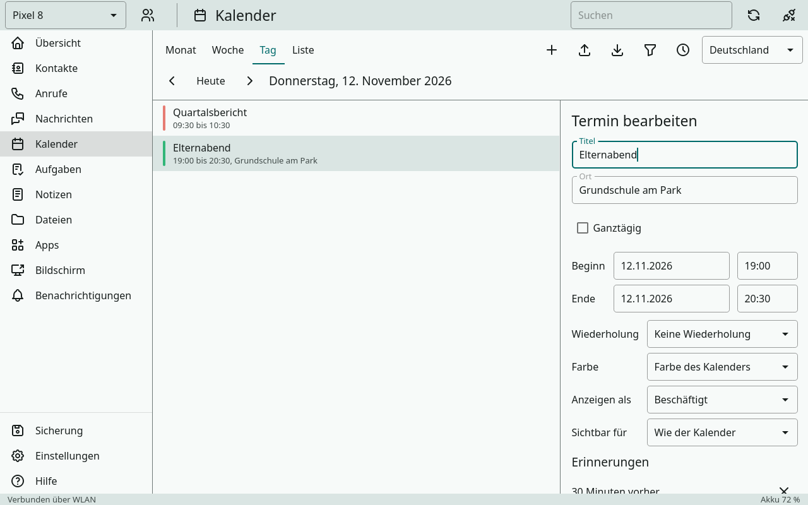

# Kalender

Der Kalender zeigt die Termine des Handys nach Monat, Woche, Tag oder als Liste. Sie legen Termine an, ändern und löschen sie.

Die Termine erscheinen, nachdem Sie einmal mit **Abgleichen** geladen haben. Der Abgleich holt Termine und Aufgaben zusammen. Ohne Verbindung sehen Sie den Stand vom letzten Abgleich.

## Das sehen Sie

Über dem Kalender stehen links die Reiter **Monat**, **Woche**, **Tag** und **Liste**. Rechts davon stehen diese Symbole und ein Feld:

| Symbol | Name | Wirkung |
|---|---|---|
| Plus | **Neuer Termin** | Legt einen Termin an |
| Pfeil nach oben | **Termine und Aufgaben importieren** | Liest eine iCalendar-Datei ein |
| Pfeil nach unten | **Termine und Aufgaben exportieren** | Schreibt Termine und Aufgaben in eine iCalendar-Datei |
| Trichter | **Kalender wählen** | Wählt die Kalender, die QPhoneManager zeigt und abgleicht |
| Uhr | **Wecker** | Öffnet die Wecker des Handys |
| Feld **Feiertage anzeigen für** | | Blendet gesetzliche Feiertage ein |

Darunter wechseln Sie mit **Früher** und **Später** (Pfeile) die Zeit und springen mit **Heute** zum heutigen Tag. Die Mitte zeigt den Zeitraum.

- **Monat und Woche:** Links steht ein Raster mit den Terminen jedes Tages, rechts die Termine des gewählten Tages. Die Woche zeigt die Kalenderwoche.
- **Tag:** Die Termine des Tages stehen als Liste.
- **Liste:** Alle Termine des Monats stehen untereinander.

Ein farbiger Strich oder Punkt zeigt die Farbe des Termins. Die Tasten Pfeil links und rechts wechseln im Raster um einen Tag, Pfeil hoch und runter um eine Woche. Bild hoch und Bild runter wechseln den Zeitraum. Eingabe öffnet den Tag.

Das Suchfeld in der Kopfzeile sucht in Titel und Ort der Termine.

## Termin anlegen

1. Wählen Sie **Neuer Termin**, **Neuer Termin** neben dem Tag rechts oder drücken Sie Strg+N.
2. Geben Sie den **Titel** ein und bei Bedarf den **Ort**.
3. Geben Sie **Beginn** und **Ende** ein. Bei einem Termin über den ganzen Tag setzen Sie das Häkchen bei **Ganztägig**.
4. Wählen Sie unter **Kalender** den Kalender. Dort stehen nur Kalender, in die das Handy schreiben darf.
5. Wählen Sie bei Bedarf **Wiederholung**, **Farbe**, **Anzeigen als** und **Sichtbar für**.
6. Fügen Sie bei Bedarf Erinnerungen hinzu.
7. Wählen Sie **Speichern**.

Das Datum geben Sie im Datumsformat Ihres Systems ein. Das leere Feld zeigt das Muster. Fehlen Titel oder Beginn, oder liegt das Ende vor dem Beginn, sagt QPhoneManager es beim Speichern.

**Wiederholung** bietet **Keine Wiederholung**, **Jeden Tag**, **Jede Woche**, **Jeden Monat** und **Jedes Jahr**. Eine Regel, die auf dem Handy mit mehr Möglichkeiten angelegt wurde, zeigt QPhoneManager als **Wiederholt sich nach eigener Regel**.

**Erinnerungen:** Wählen Sie einen Zeitpunkt, von **Zu Beginn** bis **7 Tage vorher**, und dann **Erinnerung hinzufügen**. Das Kreuz neben einer Erinnerung entfernt sie.

Ein neuer Termin geht beim Speichern sofort an das Handy.

## Termin ändern oder löschen

1. Wählen Sie den Termin in der Liste.
2. Wählen Sie **Bearbeiten** und ändern Sie ihn, oder wählen Sie **Löschen**.
3. Bestätigen Sie beim Löschen die Frage mit **Löschen**.

**Zurück zum Tag** schließt die Angaben des Termins. Termine in einem Kalender, in den das Handy nicht schreiben darf, lassen sich nur lesen.

Bei einem wiederkehrenden Termin gibt es zwei Wege:

- **Diesen Termin auslassen** entfernt nur den gewählten Tag aus der Serie. Im Formular zeigt QPhoneManager, wie oft ein Termin ausgelassen ist, und bietet **Zurückholen** an.
- **Serie löschen** löscht den Termin mit allen Wiederholungen auf dem Handy und auf diesem Rechner.

Hat sich ein Termin auf dem Handy geändert, seit QPhoneManager ihn geladen hat, öffnet sich der Dialog **Der Termin wurde auf dem Handy geändert**. Wählen Sie **Meine Fassung speichern**, **Fassung des Handys behalten** oder **Weiter bearbeiten**.

## Kalender wählen

Ein Handy hat oft mehrere Kalender, zum Beispiel je Konto.

1. Wählen Sie **Kalender wählen**. Der Dialog **Kalender auf dem Handy** öffnet sich.
2. Setzen Sie vor jedem Kalender, den QPhoneManager zeigen und abgleichen soll, ein Häkchen. Mit der Leertaste nehmen Sie den gewählten Kalender auf oder heraus.
3. Wählen Sie bei **Für neue** den Kalender, in den neue Termine gehen. Mit Eingabe machen Sie den gewählten Kalender dazu.
4. Wählen Sie **Übernehmen**.

Unter dem Namen eines Kalenders steht sein Konto. Bei einem Kalender, in den das Handy nicht schreiben darf, steht dahinter **nur lesen**. Er nimmt keine neuen Termine an. Die Auswahl lässt sich nur bei stehender Verbindung ändern. Das Handy gleicht danach die gewählten Kalender ab.

## Importieren und exportieren

- **Termine und Aufgaben importieren** liest Dateien im Format iCalendar (.ics, .ical, .ifb, .vcs). Es braucht einen Kalender, in den das Handy schreiben darf. Einträge ohne Titel oder Beginn lässt QPhoneManager aus und nennt die Zahl.
- **Termine und Aufgaben exportieren** schreibt eine iCalendar-Datei (.ics).

## Feiertage

Im Feld **Feiertage anzeigen für** wählen Sie **Keine Feiertage**, **Deutschland**, **Österreich** oder **Schweiz**. QPhoneManager zeigt die Feiertage im Raster und in der Liste. Die Wahl bleibt gespeichert.

Es erscheinen nur Feiertage, die im ganzen Land gelten. Feiertage einzelner Bundesländer, Kantone oder Regionen fehlen.

## Wecker

**Wecker** öffnet den Dialog **Wecker auf dem Handy** mit der Liste der Wecker. Jeder Wecker zeigt Uhrzeit, Name, Wochentage und **An** oder **Aus**.

- **Wecker ändern:** Wählen Sie einen Wecker, ändern Sie **Uhrzeit**, **Name**, die Wochentage oder **Wecker ist an** und wählen Sie **Speichern**.
- **Neuer Wecker:** Wählen Sie **Neuen Wecker eingeben**, füllen Sie die Felder aus und wählen Sie **Speichern**.

Nicht jedes Handy lässt die App an die Wecker. Dann steht im Dialog **Nicht unterstützt** mit dem Rat, die Wecker am Handy selbst zu stellen. Löschen lassen sich Wecker hier nicht.
