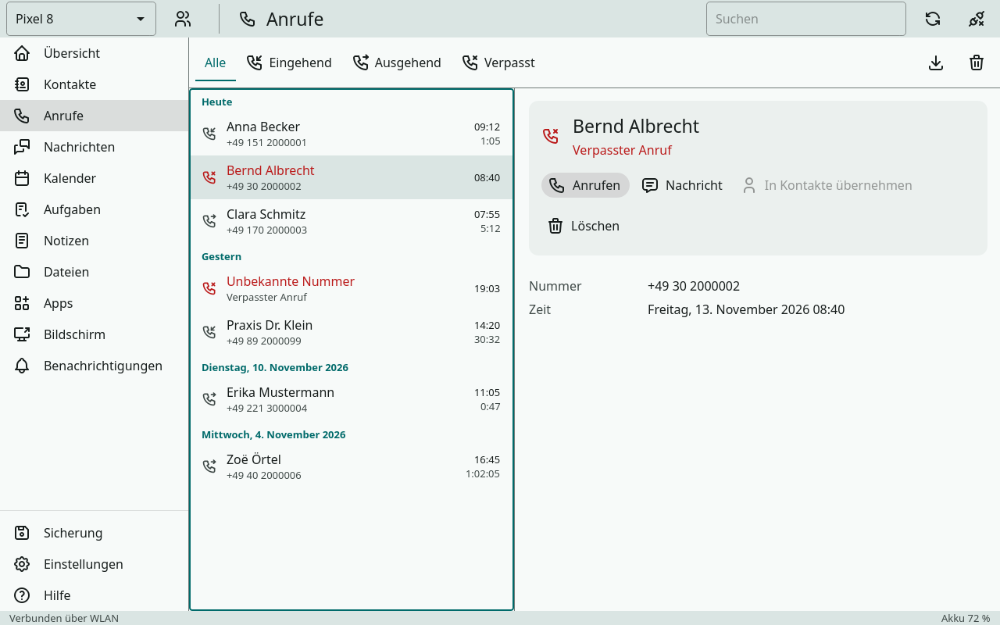

# Anrufe

Die Anrufliste zeigt eingehende, ausgehende und verpasste Anrufe mit den Namen aus Ihren Kontakten.

Die Anrufe erscheinen, nachdem Sie einmal mit **Abgleichen** geladen haben. Ohne Verbindung sehen Sie die Liste vom letzten Abgleich.

## Das sehen Sie

Die Liste ist nach Tagen gegliedert. Jeder Eintrag zeigt Namen oder Nummer, die Art des Anrufs, die Uhrzeit und bei geführten Gesprächen die Dauer. Verpasste Anrufe sind rot. Ein Anruf ohne Nummer heißt **Unbekannte Nummer**.

Die Reiter über der Liste filtern nach **Alle**, **Eingehend**, **Ausgehend** und **Verpasst**. Das Suchfeld in der Kopfzeile sucht in Namen und Nummern.

Rechts stehen die Angaben des gewählten Anrufs: **Nummer**, **Zeit**, **Dauer** und bei mehreren SIM-Karten die **SIM-Karte**. Ist die Nummer unterdrückt, steht dort **Unterdrückt**.

Ganz rechts über der Liste stehen zwei Symbole:

| Symbol | Name | Wirkung |
|---|---|---|
| Pfeil nach unten | **Anrufe der Liste exportieren** | Schreibt die angezeigten Anrufe in eine Tabelle (.csv) |
| Papierkorb | **Anrufe der Liste löschen** | Löscht alle angezeigten Anrufe |

## Zurückrufen und schreiben

Wählen Sie einen Anruf. Dann stehen diese Knöpfe zur Verfügung:

- **Anrufen:** Das Handy ruft die Nummer an. Das Gespräch führen Sie am Handy. Der Knopf geht nur bei stehender Verbindung.
- **Nachricht:** Öffnet im Bereich [Nachrichten](messages.md) eine neue Nachricht an die Nummer.
- **In Kontakte übernehmen:** Öffnet im Bereich [Kontakte](contacts.md) ein Formular mit Nummer und Namen. Der Knopf ist grau, wenn die Nummer schon einen Kontakt hat.

## Anrufe löschen

1. Wählen Sie den Anruf und drücken Sie Entf, oder wählen Sie **Löschen**. Für alle angezeigten Anrufe wählen Sie **Anrufe der Liste löschen**.
2. Bestätigen Sie die Frage mit **Löschen**.

Die Anrufliste auf dem Handy lässt sich mit MyPhoneExplorer Client 4.15 nicht ändern. Dem Programm fehlt dafür die Berechtigung. Lehnt die App das Löschen ab, bleiben die Anrufe auf dem Handy und in der Liste. QPhoneManager meldet das und bittet Sie, den Anruf direkt auf dem Handy zu löschen.

## Exportieren

1. Wählen Sie bei Bedarf einen Reiter und geben Sie einen Suchtext ein. Der Export enthält nur die angezeigten Anrufe.
2. Wählen Sie **Anrufe der Liste exportieren**.
3. Wählen Sie im Dateidialog Ort und Namen der Tabelle.
