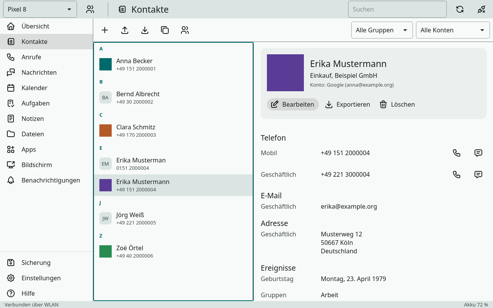
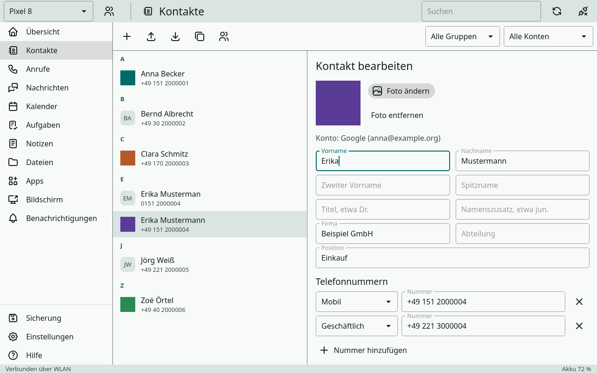

# Kontakte

Hier sehen und bearbeiten Sie die Kontakte des Handys. Beim Speichern geht jede Änderung sofort an das Handy.

Die Kontakte erscheinen, nachdem Sie einmal mit **Abgleichen** geladen haben. Spätere Abgleiche holen nur, was sich geändert hat.

## Das sehen Sie

Links steht die Liste, nach Anfangsbuchstaben geordnet, mit Foto oder Initialen und der ersten Nummer. Rechts stehen die Angaben des gewählten Kontakts: Nummern, E-Mail-Adressen, Adressen, Webseiten, Messenger, Ereignisse, Gruppen und Notiz. Neben jeder Nummer gibt es ein Symbol zum Anrufen und eines zum Schreiben einer Nachricht.

Über der Liste steht die Werkzeugleiste:

| Symbol | Name | Wirkung |
|---|---|---|
| Plus | **Neuer Kontakt** | Legt einen Kontakt an |
| Pfeil nach oben | **Kontakte importieren** | Liest eine Datei mit Kontakten ein |
| Pfeil nach unten | **Kontakte der Liste exportieren** | Schreibt die Kontakte der Liste in eine Datei |
| Zwei Quadrate | **Doppelte Kontakte suchen** | Öffnet die Suche nach Dubletten |
| Zwei Personen | **Konto für neue Kontakte** | Wählt das Konto, in dem neue Kontakte landen |

Rechts außen filtern die Felder **Alle Gruppen** und **Alle Konten** die Liste. Das Feld für Konten erscheint nur, wenn das Handy mehr als ein Konto hat. **Konto für neue Kontakte** ist nur dann wählbar.

## Kontakte suchen

Tippen Sie in das Suchfeld oben. Die Liste zeigt die Kontakte, bei denen der Text im Namen, im Spitznamen, in der Firma oder in einer E-Mail-Adresse steht. Eine Nummer finden Sie ab drei Ziffern. Groß- und Kleinschreibung und Akzente zählen nicht: Müller und muller treffen denselben Kontakt.

## Kontakt anlegen

1. Wählen Sie **Neuer Kontakt** oder drücken Sie Strg+N. Rechts öffnet sich das Formular.
2. Hat das Handy mehrere Konten, wählen Sie unter **Speichern im Konto** das Konto.
3. Füllen Sie die Felder aus. Es genügt ein Name, eine Nummer, eine E-Mail-Adresse oder eine Firma.
4. Wählen Sie **Speichern**.

Das Formular hat diese Teile:

- **Foto:** **Foto ändern** öffnet einen Dateidialog. Danach wählen Sie den Bildausschnitt. **Foto entfernen** löscht das Foto.
- **Name:** Vorname, Nachname, Zweiter Vorname, Spitzname, Titel vor dem Namen und Zusatz nach dem Namen.
- **Firma, Abteilung, Position**
- **Telefonnummern, E-Mail-Adressen, Adressen, Webseiten, Messenger:** Jeder Eintrag hat eine Art, zum Beispiel Mobil, Privat oder Geschäftlich, oder eine **Eigene Bezeichnung**. Mit Knöpfen wie **Nummer hinzufügen** oder **E-Mail-Adresse hinzufügen** fügen Sie Zeilen hinzu. Das Kreuz neben einer Zeile entfernt sie.
- **Ereignisse:** Geburtstag, Jahrestag und weitere Ereignisse. Das Feld zeigt ein Beispiel im Datumsformat Ihres Systems.
- **Gruppen:** Setzen Sie Häkchen bei den Gruppen des Handys, oder legen Sie unter **Neue Gruppe** eine neue an.
- **Notiz**

Das Handy nimmt höchstens 20 Einträge je Art und ein kleines Foto an. Ist ein Foto zu groß, wählen Sie ein anderes oder einen größeren Ausschnitt.

## Kontakt ändern

1. Wählen Sie den Kontakt in der Liste.
2. Wählen Sie **Bearbeiten**.
3. Ändern Sie die Felder und wählen Sie **Speichern**.

Zum Handy gehen nur die Einträge, die Sie geändert haben. Alle anderen bleiben dort unverändert. Das Konto eines Kontakts lässt sich nicht ändern.

Hat sich der Kontakt auf dem Handy geändert, seit QPhoneManager ihn geladen hat, öffnet sich der Dialog **Der Kontakt wurde auf dem Handy geändert**. Er zeigt beide Fassungen nebeneinander. Wählen Sie dann:

- **Meine Fassung speichern**, um die Handy-Fassung zu überschreiben.
- **Fassung des Handys behalten**, um Ihre Änderungen zu verwerfen.
- **Weiter bearbeiten**, um zum Formular zurückzukehren.

## Kontakt löschen

1. Wählen Sie den Kontakt und drücken Sie Entf, oder wählen Sie **Löschen** in den Angaben des Kontakts.
2. Bestätigen Sie die Frage mit **Löschen**.

QPhoneManager löscht den Kontakt auf dem Handy und auf diesem Rechner.

## Anrufen und schreiben

- Das Symbol mit dem Hörer neben einer Nummer lässt das Handy diese Nummer anrufen. Das Gespräch führen Sie am Handy.
- Das Symbol mit der Sprechblase öffnet im Bereich [Nachrichten](messages.md) eine neue Nachricht an diese Nummer.

## Doppelte Kontakte

1. Wählen Sie **Doppelte Kontakte suchen**.
2. Der Dialog nennt Paare mit gleicher Telefonnummer, gleicher E-Mail-Adresse oder ähnlichem Namen.
3. Wählen Sie bei einem Paar **Zusammenführen** oder **Ignorieren**.

Beim Zusammenführen bleibt der erste Kontakt. Er erhält, was nur der zweite hat. Der zweite wird auf dem Handy gelöscht.

## Importieren und exportieren

- **Importieren:** Wählen Sie **Kontakte importieren** und eine Datei im Format vCard (.vcf) oder eine als CSV gespeicherte Tabelle. QPhoneManager liest vCard in den Versionen 2.1, 3.0 und 4.0. Die Kontakte landen auf dem Handy. Kontakte, die das Handy nicht annimmt, lässt QPhoneManager aus und nennt die Zahl.
- **Exportieren:** **Kontakte der Liste exportieren** schreibt alle Kontakte, die die Liste zeigt, mit Suche und Filter. In den Angaben eines Kontakts schreibt **Exportieren** nur diesen Kontakt. Sie wählen vCard (.vcf, Version 3.0) oder Tabelle (.csv).

## Hinweise

- Ohne Verbindung sehen Sie die Kontakte vom letzten Abgleich, aber Sie ändern nichts.
- Eine Tabelle schreibt QPhoneManager so, dass Zellen, die wie eine Formel beginnen, in der Tabellenkalkulation nicht als Formel laufen.
