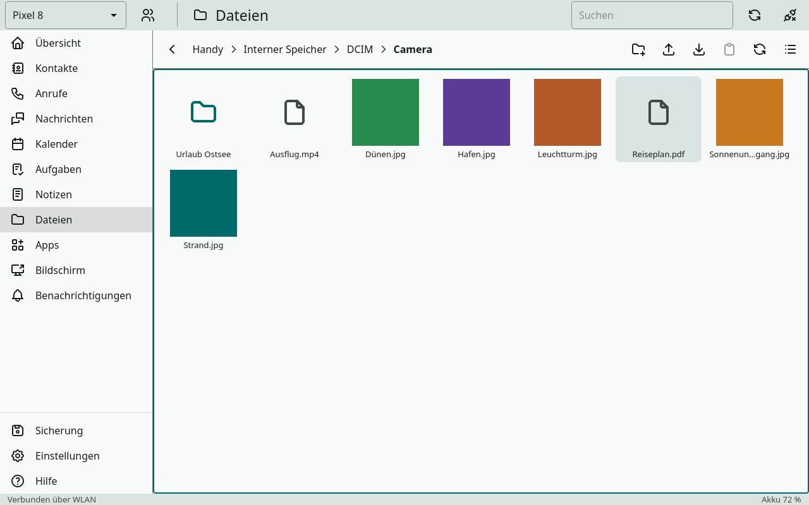
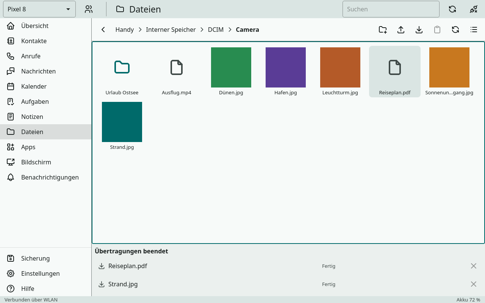

# Dateien

Hier kopieren Sie Dateien zwischen Handy und Rechner und legen Ordner an. Außerdem benennen Sie Dateien um, verschieben und löschen sie.

Die Dateien kommen live vom Handy. QPhoneManager fragt sie ab, sobald Sie den Bereich öffnen. Das Kopieren, die Vorschaubilder und das Öffnen von Dateien gehen nur über WLAN oder USB, nicht über Bluetooth.

Damit die App Ihre Dateien sehen darf, braucht sie unter Android den Zugriff auf alle Dateien. Fehlt er, meldet QPhoneManager es. Erlauben Sie ihn dann in den Android-Einstellungen für MyPhoneExplorer Client.

## Das sehen Sie

Die oberste Ebene heißt **Handy**. Sie zeigt die Speicher, die das Handy meldet, zum Beispiel **Interner Speicher**, **Speicherkarte**, **Telefonspeicher** oder **Zweitprofil**. Darunter öffnen Sie Ordner wie im Dateimanager. Die Pfadleiste zeigt, wo Sie sind. Ein Klick auf einen Teil des Pfads springt dorthin.

Die Ansicht ist ein Raster mit Vorschaubildern für Bilder oder eine Liste mit Größe und Änderungszeit. **Als Liste zeigen** und **Als Raster zeigen** wechseln zwischen beiden.

In der Werkzeugleiste stehen von links nach rechts:

| Symbol | Name | Wirkung |
|---|---|---|
| Pfeil nach links | **Zum übergeordneten Ordner** | Geht eine Ebene hoch |
| Ordner mit Plus | **Neuer Ordner** | Legt im offenen Ordner einen Ordner an |
| Pfeil nach oben | **Dateien von diesem Rechner kopieren** | Öffnet ein Menü mit **Dateien kopieren** und **Ordner kopieren** |
| Pfeil nach unten | **Auf diesem Rechner speichern** | Kopiert den gewählten Eintrag auf diesen Rechner |
| Klemmbrett | **Hier einfügen** | Fügt ausgeschnittene Einträge im offenen Ordner ein |
| Zwei Pfeile im Kreis | **Ordner neu laden** | Liest den Ordner noch einmal |
| Liste oder Raster | **Als Liste zeigen** oder **Als Raster zeigen** | Wechselt die Ansicht |

Die Suche in der Kopfzeile ist hier nicht aktiv.

## Dateien vom Handy auf den Rechner kopieren

1. Öffnen Sie den Ordner mit der Datei.
2. Wählen Sie die Datei oder den Ordner.
3. Wählen Sie **Auf diesem Rechner speichern**, oder öffnen Sie mit Rechtsklick das Menü und wählen Sie **Auf diesem Rechner speichern**.
4. Wählen Sie im Dateidialog den Ordner auf dem Rechner.

Sie können eine Datei auch aus dem Raster oder der Liste in Ihren Dateimanager ziehen. Das geht für Dateien, nicht für Ordner.

## Dateien vom Rechner auf das Handy kopieren

1. Öffnen Sie auf dem Handy den Zielordner. Auf der obersten Ebene **Handy** lässt sich nichts kopieren.
2. Wählen Sie **Dateien von diesem Rechner kopieren** und dann **Dateien kopieren** oder **Ordner kopieren**.
3. Wählen Sie im Dateidialog die Dateien oder den Ordner.

Sie können Dateien und Ordner auch aus Ihrem Dateimanager in die Dateiansicht ziehen. Sie landen im offenen Ordner.

Unten erscheint die Liste der Übertragungen. Jede Zeile zeigt den Zustand: **Wartet**, **Ordner wird gelesen**, den Fortschritt in Prozent, **Fertig**, **Übersprungen** oder **Abgebrochen**. Das Kreuz in einer Zeile bricht diese Übertragung ab. **Alle abbrechen** bricht alle ab. **Liste leeren** räumt die beendeten Übertragungen weg. Die Statuszeile zeigt, wie weit die laufende Übertragung ist.

Gibt es am Ziel schon eine Datei mit dem Namen, fragt QPhoneManager nach. Der Dialog nennt die Datei, und Sie wählen:

- **Ersetzen:** Die vorhandene Datei wird überschrieben.
- **Beide behalten:** Die neue Datei bekommt einen anderen Namen.
- **Überspringen:** Diese Datei wird nicht kopiert.

Mit dem Häkchen **Bei den weiteren Dateien genauso entscheiden** gilt die Wahl für den Rest dieser Übertragung.

Namen, die auf dem Ziel nicht erlaubt sind, lässt QPhoneManager aus und nennt die Zahl.

## Ordner anlegen, umbenennen, verschieben, löschen

Wählen Sie den Eintrag und dann:

- **Neuer Ordner** oder Strg+N: Geben Sie den Namen ein und wählen Sie **Anlegen**.
- **Umbenennen** im Menü oder F2: Geben Sie den neuen Namen ein und wählen Sie **Umbenennen**.
- **Ausschneiden** im Menü oder Strg+X, dann den Zielordner öffnen und **Hier einfügen** oder Strg+V: Das verschiebt den Eintrag auf dem Handy.
- **Löschen** im Menü oder Entf: Bestätigen Sie die Frage mit **Löschen**. QPhoneManager löscht die Datei oder den Ordner mit allem Inhalt auf dem Handy. Das lässt sich nicht rückgängig machen.

Ein Name darf nicht mit einem Leerzeichen beginnen oder enden und kein / oder \ enthalten. Groß- und Kleinschreibung unterscheidet das Handy nicht.

Das Menü öffnet ein Rechtsklick oder die Menütaste. Löschen, Umbenennen, Ausschneiden und Speichern wirken auf einen Eintrag.

## Dateien öffnen

Mit Eingabe oder Doppelklick öffnen Sie einen Ordner. Bei einer Datei lädt QPhoneManager sie auf den Rechner und öffnet sie mit dem Standardprogramm dafür. Gibt es auf dem Rechner kein Programm für den Dateityp, meldet QPhoneManager es.

## Tastatur

| Taste | Wirkung |
|---|---|
| Eingabe | Ordner oder Datei öffnen |
| Rücktaste | Eine Ebene höher |
| F2 | Umbenennen |
| Entf | Löschen |
| Strg+X und Strg+V | Ausschneiden und Einfügen |
| Strg+N | Neuer Ordner |
| Menütaste | Menü öffnen |
