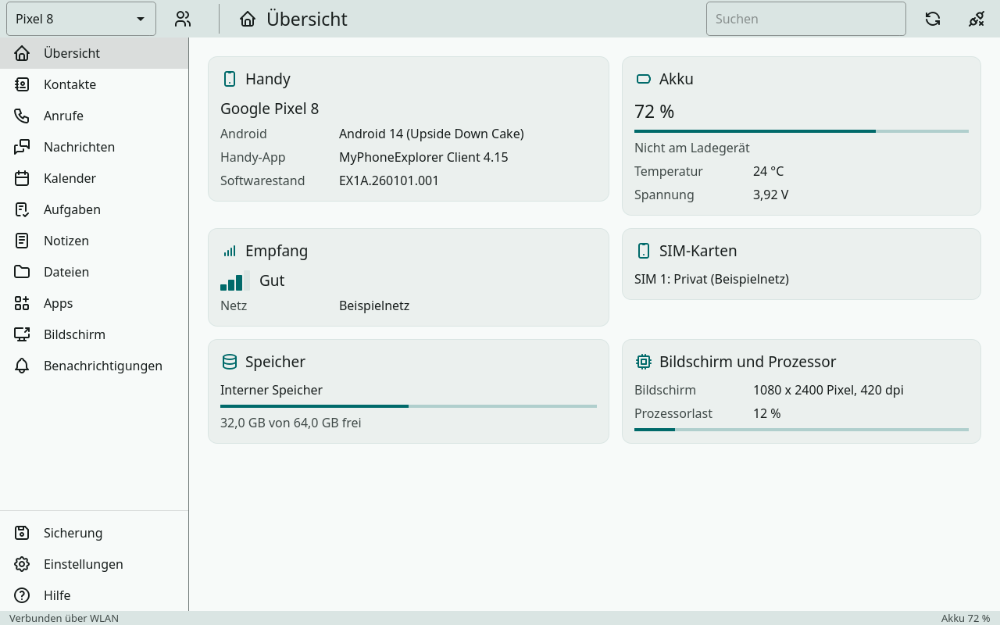
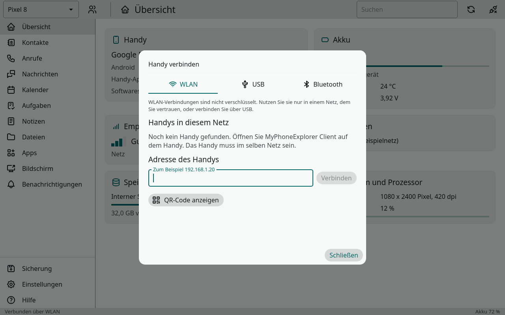
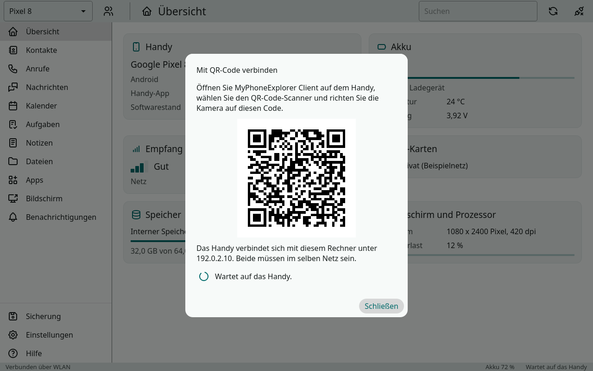
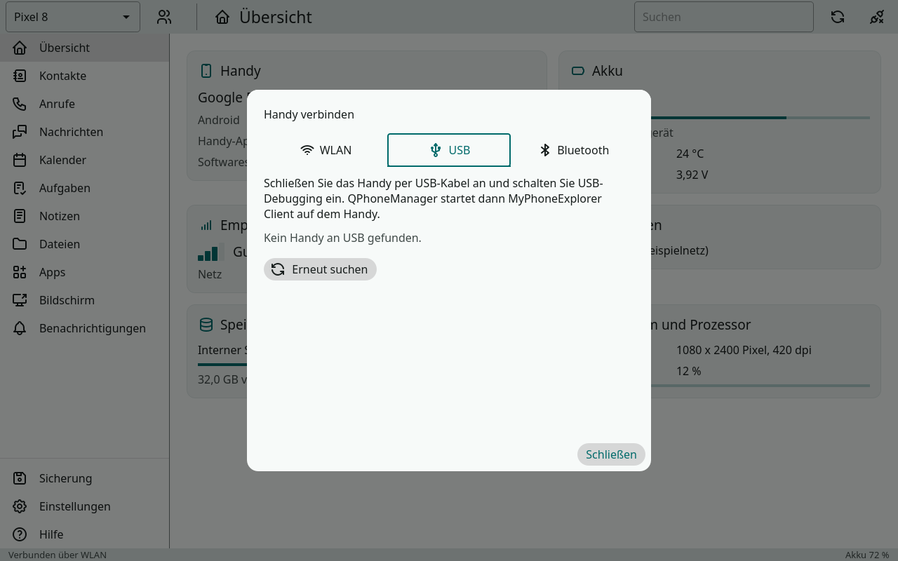
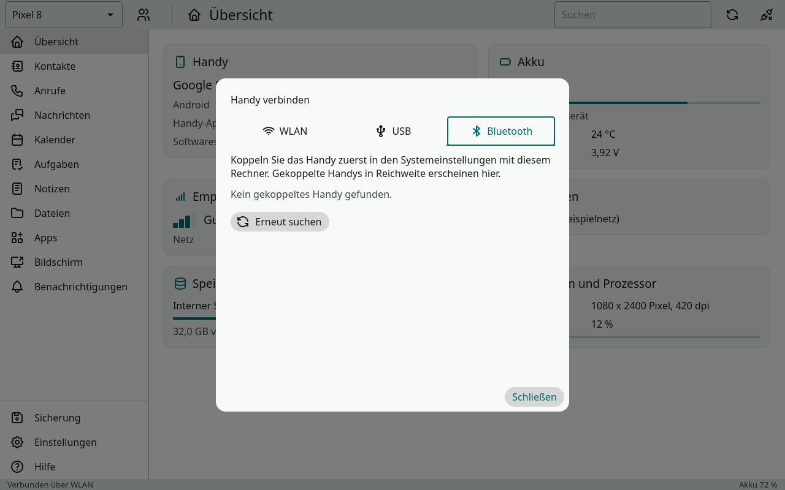
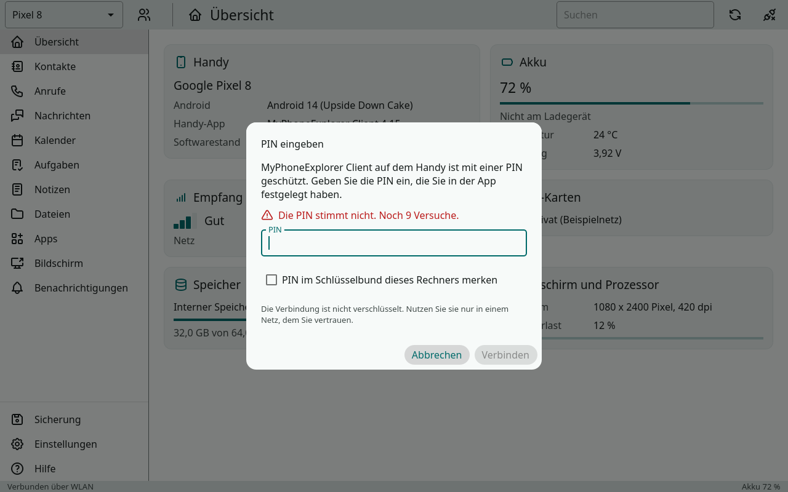

# Erste Schritte

QPhoneManager verbindet Ihr Android-Handy mit diesem Rechner. Sie sehen und bearbeiten Kontakte, Anrufe, Nachrichten, Kalender, Aufgaben und Notizen. Sie kopieren Dateien, verwalten Apps, spiegeln den Handybildschirm und sichern Ihre Daten in eine Datei.

Auf dem Handy brauchen Sie dazu die App MyPhoneExplorer Client. QPhoneManager ist ein eigenständiges Programm und gehört nicht zum Hersteller dieser App.

## Was Sie brauchen

- Auf dem Handy: die App MyPhoneExplorer Client in Version 4.15. QPhoneManager ist für diese Version gemacht. Die App ist bei Google Play erhältlich.
- Auf dem Rechner: Linux. Für Verbindungen über USB brauchen Sie außerdem das Programm adb aus den Android Platform Tools.
- Für Bluetooth: Das Handy muss in den Systemeinstellungen des Rechners gekoppelt sein.

Wie Sie QPhoneManager bauen und starten, steht in der Datei README.md im Quelltext des Programms.

## Das Hauptfenster

- **Seitenleiste links:** Sie zeigt die Bereiche des Programms. Unten stehen **Sicherung**, **Einstellungen** und **Hilfe**. Ist das Fenster schmaler als 1200 Pixel, zeigt die Seitenleiste nur Symbole.
- **Kopfzeile:** Links wählen Sie das Handy. Daneben öffnet **Handys verwalten** die Liste aller Handys. Rechts stehen das Suchfeld, **Abgleichen** (zwei Pfeile im Kreis) und **Verbinden** oder **Trennen** (Stecker).
- **Inhalt:** Liste und Einzelansicht stehen nebeneinander. Ist der Inhalt schmaler als 900 Pixel, sehen Sie nur eines von beiden. **Zurück** führt zur Liste.
- **Statuszeile unten:** Sie zeigt die Verbindung, den Akkustand des Handys und laufende Übertragungen.
- **Meldungen:** Ergebnisse und Fehler erscheinen in einer Leiste über dem Inhalt. **Meldung schließen** blendet sie aus.

Die Symbole in den Werkzeugleisten tragen keinen Text. Halten Sie den Mauszeiger über ein Symbol, dann erscheint sein Name.

Das Suchfeld filtert die Liste des geöffneten Bereichs. Es ist nur aktiv, wo eine Liste mit Daten da ist.

### Tastatur

| Taste | Wirkung |
|---|---|
| Strg+1 bis Strg+9 | Die ersten neun Bereiche der Seitenleiste öffnen |
| Strg+F | In das Suchfeld wechseln |
| F5 | Abgleichen, wenn das Handy verbunden ist |
| Strg+N | Neuen Eintrag anlegen, wo der Bereich das anbietet |
| Strg+, | Einstellungen öffnen |
| F1 | Hilfe zum offenen Bereich öffnen |
| Strg+Q | QPhoneManager beenden |

## Handy zum ersten Mal verbinden

Wählen Sie oben rechts **Verbinden**. In einem leeren Bereich gibt es denselben Knopf in der Mitte. Es öffnet sich der Dialog **Handy verbinden** mit den Reitern **WLAN**, **USB** und **Bluetooth**.

### Über WLAN

Das Handy und der Rechner müssen im selben Netz sein.

1. Öffnen Sie MyPhoneExplorer Client auf dem Handy.
2. Wählen Sie in QPhoneManager **Verbinden** und den Reiter **WLAN**. QPhoneManager sucht gleich im Netz nach Handys.
3. Wählen Sie Ihr Handy unter **Handys in diesem Netz**.

Findet QPhoneManager das Handy nicht, geben Sie die Adresse selbst ein. MyPhoneExplorer Client zeigt sie auf dem Handy an. Tragen Sie sie unter **Adresse des Handys** ein, zum Beispiel 192.168.1.20, und wählen Sie **Verbinden**.

Der dritte Weg ist der QR-Code:

1. Wählen Sie **QR-Code anzeigen**.
2. Öffnen Sie MyPhoneExplorer Client auf dem Handy und wählen Sie den QR-Code-Scanner.
3. Richten Sie die Kamera auf den Code am Bildschirm. Das Handy verbindet sich dann selbst mit dem Rechner.

Der Code enthält die Adresse dieses Rechners. Solange das Fenster mit dem Code offen ist, wartet der Rechner auf das Handy. Die Statuszeile zeigt dann **Wartet auf das Handy**. Was die App beim Scannen selbst an ihren Hersteller meldet, liegt bei der App. QPhoneManager ruft keine Dienste des Herstellers auf.

WLAN-Verbindungen sind nicht verschlüsselt. Nutzen Sie sie nur in einem Netz, dem Sie vertrauen, oder verbinden Sie über USB.

### Über USB

1. Schließen Sie das Handy mit einem USB-Kabel an den Rechner an.
2. Schalten Sie auf dem Handy USB-Debugging ein und erlauben Sie dem Rechner den Zugriff.
3. Wählen Sie in QPhoneManager **Verbinden** und den Reiter **USB**.
4. Wählen Sie Ihr Handy unter **Handys an USB**.

QPhoneManager startet MyPhoneExplorer Client auf dem Handy selbst. Ist die Liste leer, wählen Sie **Erneut suchen**. Fehlt das Programm adb, nennen Sie seinen Pfad in den Einstellungen unter **Verbindung**.

### Über Bluetooth

1. Koppeln Sie das Handy in den Systemeinstellungen mit dem Rechner.
2. Wählen Sie in QPhoneManager **Verbinden** und den Reiter **Bluetooth**.
3. Wählen Sie Ihr Handy unter **Gekoppelte Handys**.

Über Bluetooth gehen Dateiübertragungen, Vorschaubilder, das Sichern und Installieren von Apps und die Bildschirmspiegelung nicht. Dafür brauchen Sie WLAN oder USB.

### Die PIN

Schützt eine PIN die App auf dem Handy, fragt QPhoneManager danach. Die App schützt damit WLAN-Verbindungen.

1. Geben Sie im Dialog **PIN eingeben** die PIN ein, die Sie in der App festgelegt haben.
2. Setzen Sie bei Bedarf das Häkchen bei **PIN im Schlüsselbund dieses Rechners merken**. QPhoneManager nutzt die gemerkte PIN beim nächsten Verbinden von selbst.
3. Wählen Sie **Verbinden**.

Eine falsche PIN meldet QPhoneManager mit der Zahl der übrigen Versuche. Nach zu vielen falschen PINs beendet sich die App auf dem Handy. Öffnen Sie sie dann erneut und verbinden Sie noch einmal.

Erreicht QPhoneManager den Schlüsselbund des Systems nicht, speichert es die PIN nicht und fragt jedes Mal neu. Die PIN schützt nur schwach. Verbinden Sie bevorzugt über USB oder in einem Netz, dem Sie vertrauen.

## Nach dem Verbinden

Die Statuszeile zeigt **Verbunden über WLAN**, **USB** oder **Bluetooth**. Die **Übersicht** zeigt den Zustand des Handys.

Kontakte, Anrufe, Nachrichten, Kalender, Aufgaben und Notizen lädt QPhoneManager erst, wenn Sie **Abgleichen** wählen oder F5 drücken. Danach meldet eine Leiste je Bereich, was neu, geändert oder gelöscht ist. Spätere Abgleiche holen bei Kontakten, Nachrichten, Kalender, Aufgaben und Notizen nur die Änderungen. Die Anrufliste liest QPhoneManager jedes Mal ganz neu. Dateien, Apps, Benachrichtigungen und der Bildschirm kommen live vom Handy. Sie gehören nicht zum Abgleich.

Ohne Verbindung zeigt QPhoneManager die Daten vom letzten Abgleich. Ein Hinweis oben nennt das Datum. Bearbeiten lässt sich nur bei stehender Verbindung.

Beim Start verbindet sich QPhoneManager mit dem zuletzt genutzten Handy. Es versucht die Wege in der Reihenfolge aus den Einstellungen, und nur die, über die das Handy schon einmal verbunden war. Nach einem Abbruch verbindet es sich bei WLAN und USB selbst neu. Bei Bluetooth und bei einer Verbindung per QR-Code tut es das nicht. Beides lässt sich in den Einstellungen abschalten.

## Wenn die Verbindung nicht klappt

Jede Meldung von QPhoneManager nennt den Grund und den nächsten Schritt. Die häufigsten Fälle:

**Kein Handy gefunden (WLAN)**

1. Öffnen Sie MyPhoneExplorer Client auf dem Handy.
2. Prüfen Sie, ob Handy und Rechner im selben Netz sind.
3. Geben Sie sonst die Adresse des Handys von Hand ein.

**Die App lässt keine WLAN-Verbindungen zu**

1. Erlauben Sie WLAN-Verbindungen in den Einstellungen von MyPhoneExplorer Client auf dem Handy.
2. Verbinden Sie noch einmal, oder nutzen Sie USB.

**Das Handy ist mit einem anderen Rechner verbunden**

1. Beenden Sie die andere Verbindung.
2. Verbinden Sie noch einmal.

**Kein Handy an USB**

1. Prüfen Sie das Kabel.
2. Schalten Sie auf dem Handy USB-Debugging ein, entsperren Sie das Handy und erlauben Sie dem Rechner den Zugriff.
3. Wählen Sie **Erneut suchen**.

**Der App fehlt eine Berechtigung auf dem Handy**

1. Öffnen Sie die Android-Einstellungen des Handys und dort die Apps.
2. Erlauben Sie MyPhoneExplorer Client die fehlende Berechtigung. Die Meldung nennt den Bereich, etwa Kontakte, Kalender, Nachrichten oder Dateien.
3. Wiederholen Sie die Aktion.

**Die App ist nicht installiert**

1. Installieren Sie MyPhoneExplorer Client aus Google Play.
2. Verbinden Sie noch einmal.

## Hilfe und Über-Dialog

F1 öffnet das Kapitel zum Bereich, den Sie gerade sehen. In den Dialogen **Einstellungen** und **Sicherung** schließt F1 den Dialog und öffnet das passende Kapitel. **Hilfe** unten in der Seitenleiste öffnet dieses Kapitel.

Die Hilfe zeigt links das Inhaltsverzeichnis. Mit **Zurück** und **Vorwärts** gehen Sie durch die Kapitel, die Sie schon gelesen haben. Mit Tab springen Sie von Link zu Link, mit Eingabe folgen Sie ihm. Links ins Netz öffnen den Browser, wenn sie mit https beginnen.

Die Hilfe erscheint in der Sprache des Programms. Fehlt ein Kapitel in dieser Sprache, zeigt sie es auf Englisch, dann auf Deutsch.

**Über QPhoneManager** oben rechts in der Hilfe zeigt die Version, die Lizenz, die Qt-Version und die Lizenzen der verwendeten Bausteine. Mit den Pfeiltasten wählen Sie einen Baustein.

## Die Bereiche des Programms

- [Übersicht](overview.md)
- [Kontakte](contacts.md)
- [Anrufe](calls.md)
- [Nachrichten](messages.md)
- [Kalender](calendar.md)
- [Aufgaben](tasks.md)
- [Notizen](notes.md)
- [Dateien](files.md)
- [Apps](apps.md)
- [Bildschirm](screen.md)
- [Benachrichtigungen](notifications.md)
- [Sichern und wiederherstellen](backup.md)
- [Einstellungen](settings.md)
