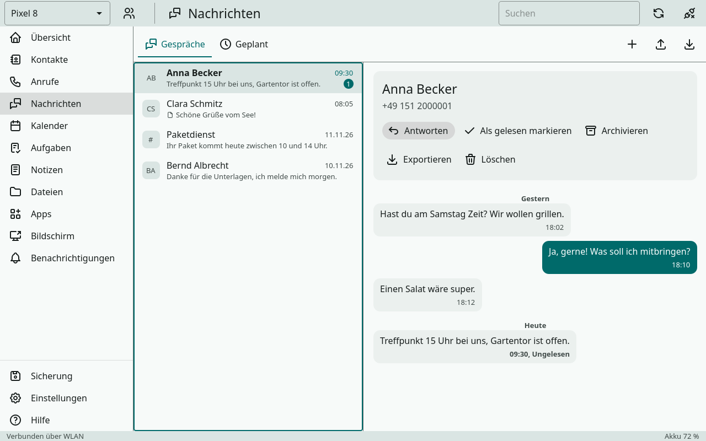
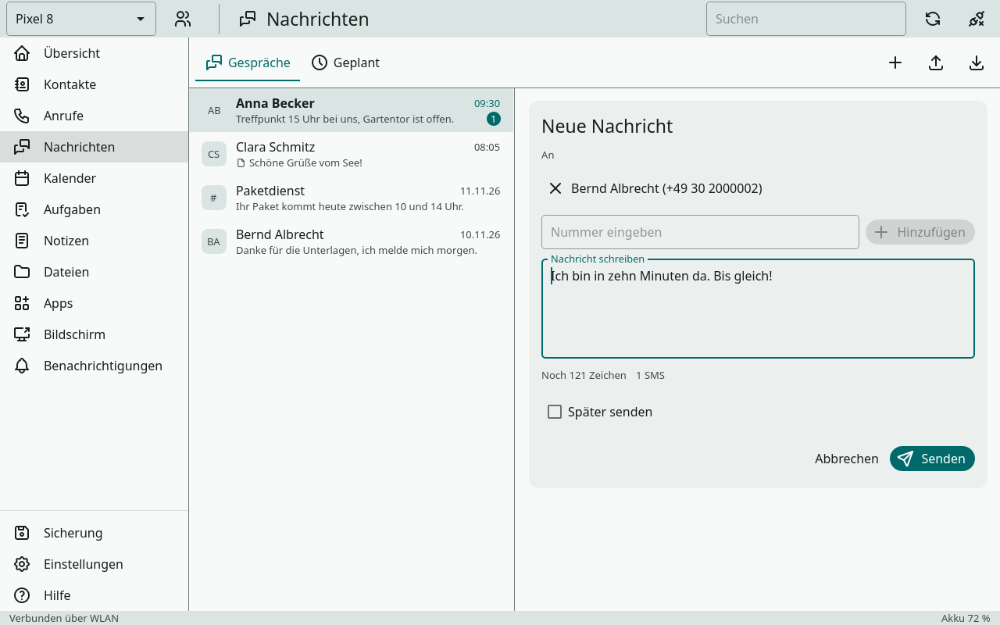

# Nachrichten

Hier lesen Sie SMS und MMS als Gespräche und schreiben neue Nachrichten. Sie archivieren Nachrichten auf diesem Rechner und planen SMS, die das Handy später sendet.

Die Nachrichten erscheinen, nachdem Sie einmal mit **Abgleichen** geladen haben. Ohne Verbindung sehen Sie die Nachrichten vom letzten Abgleich.

## Das sehen Sie

Die Reiter **Gespräche** und **Geplant** trennen die Gesprächsliste von den geplanten Nachrichten. Neben den Reitern stehen drei Symbole:

| Symbol | Name | Wirkung |
|---|---|---|
| Plus | **Neue Nachricht** | Öffnet das Schreibformular |
| Pfeil nach oben | **Archivdatei einlesen** | Liest eine Archivdatei (.xml) in das Archiv auf diesem Rechner ein |
| Pfeil nach unten | **Alle Nachrichten exportieren** | Schreibt alle Nachrichten in eine Datei |

Die Liste zeigt ein Gespräch je Gegenüber, mit dem Namen aus den Kontakten, die neueste Nachricht zuerst. Eine Zahl auf dem Eintrag nennt die ungelesenen Nachrichten. Rechts stehen die Nachrichten des gewählten Gesprächs als Sprechblasen. Ihre eigenen Nachrichten stehen rechts, die empfangenen links.

Das Suchfeld in der Kopfzeile sucht in den Texten aller Nachrichten und in Namen und Nummern.

Bilder aus MMS erscheinen im Gespräch. Andere Anhänge zeigt QPhoneManager mit Namen und Größe. Ein Anhang, der auf dem Handy geblieben ist, weil er groß ist, lässt sich nur dort speichern.

QPhoneManager meldet eine neue Nachricht, solange das Handy verbunden ist, in der Leiste über dem Inhalt. Das Gespräch wird neu geladen.

## Nachricht schreiben

Das Schreiben braucht eine stehende Verbindung. QPhoneManager sendet SMS über das Handy. MMS lassen sich nicht senden.

1. Wählen Sie **Neue Nachricht** oder drücken Sie Strg+N. Mit **Antworten** in einem Gespräch ist der Empfänger schon eingetragen.
2. Geben Sie unter **An** eine Nummer ein und wählen Sie **Hinzufügen**. Sie können bis zu 20 Empfänger eintragen. Das Kreuz vor einem Empfänger entfernt ihn.
3. Schreiben Sie den Text unter **Nachricht schreiben**. Der Zähler zeigt, wie viele Zeichen noch in die SMS passen und wie viele SMS entstehen. Sonderzeichen verkürzen die SMS.
4. Hat das Handy mehrere SIM-Karten, wählen Sie unter **SIM-Karte** die Karte.
5. Wählen Sie **Senden** oder drücken Sie Strg+Eingabe.

Ging die Nachricht nicht an alle Empfänger, nennt die Meldung, an wie viele sie ging. Bestätigt das Handy eine SMS nicht, prüfen Sie in der Liste, ob sie gesendet wurde, bevor Sie sie noch einmal senden.

## Nachricht planen

Eine geplante SMS sendet das Handy zur gewählten Zeit selbst, auch wenn dieser Rechner dann aus ist.

1. Öffnen Sie das Schreibformular wie oben.
2. Setzen Sie das Häkchen bei **Später senden**.
3. Geben Sie **Datum** und **Uhrzeit** ein. Die Zeit muss mindestens eine Minute in der Zukunft liegen.
4. Wählen Sie **Planen**.

Im Reiter **Geplant** stehen alle geplanten Nachrichten mit dem Zustand **Wartet**, **Gesendet**, **Nicht gesendet** oder **An 1 von 2 gesendet**. Wählen Sie eine Nachricht, um sie zu ändern und mit **Speichern** zu sichern, oder löschen Sie sie mit **Löschen**. **Nachricht planen** legt eine neue an.

## Archivieren

Archivierte Nachrichten bleiben auf diesem Rechner, auch wenn sie auf dem Handy gelöscht sind.

- **Archivieren** legt alle Nachrichten des gewählten Gesprächs in das Archiv.
- Ein Rechtsklick auf eine einzelne Nachricht oder die Menütaste öffnet ein Menü. **Im Archiv behalten** archiviert diese Nachricht. **Aus dem Archiv nehmen** nimmt sie wieder heraus. Eine Nachricht, die es nur noch auf diesem Rechner gibt, bleibt im Archiv. Löschen Sie sie, wenn Sie sie nicht mehr brauchen.
- **Archivdatei einlesen** fügt Nachrichten aus einer Archivdatei hinzu, die Sie vorher exportiert haben. QPhoneManager nimmt nur Nachrichten auf, die noch nicht da sind.

## Exportieren

1. Wählen Sie **Exportieren** im Gespräch oder **Alle Nachrichten exportieren**.
2. Wählen Sie im Dateidialog das Format: Tabelle (.csv), Webseite (.html) oder Archivdatei (.xml).
3. Wählen Sie Ort und Namen.

Nur die Archivdatei lässt sich später wieder einlesen.

## Anhänge speichern

- Das Symbol neben einem Anhang speichert ihn. Sein Name lautet **Dateiname speichern**, mit dem Namen des Anhangs. Ein Dateidialog fragt nach Ort und Namen.
- Im Menü einer Nachricht speichert **Alle Anhänge speichern** alle Anhänge der Nachricht in einem Ordner, den Sie wählen.

## Als gelesen markieren und löschen

- **Als gelesen markieren** und **Löschen** schickt QPhoneManager als Anfrage an das Handy. MyPhoneExplorer Client 4.15 lehnt beides für SMS ab, weil ihm die Berechtigung fehlt. Dann bleibt die Nachricht auf dem Handy und in der Liste. QPhoneManager sagt das und rät, die Nachricht auf diesem Rechner zu archivieren.
- MMS lassen sich weder löschen noch als gelesen markieren. Dafür sendet QPhoneManager keine Anfrage. Löschen Sie MMS direkt auf dem Handy.
- Vor dem Löschen fragt QPhoneManager nach. Die Frage nennt, dass das Handy SMS nur löscht, wenn seine App es erlaubt.
