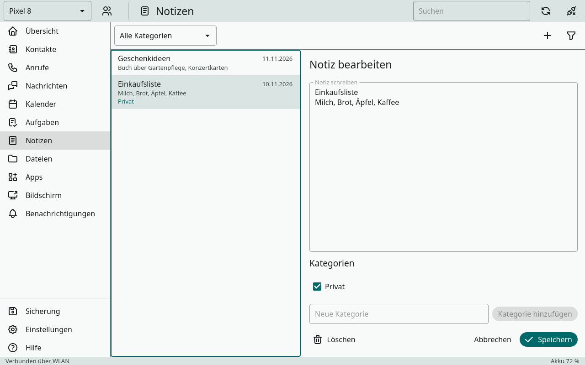

# Notizen

Hier lesen, schreiben und ordnen Sie die Notizen des Handys.

Die Notizen erscheinen, nachdem Sie einmal mit **Abgleichen** geladen haben. Ohne Verbindung sehen Sie den Stand vom letzten Abgleich.

## Das sehen Sie

Jeder Eintrag der Liste zeigt als Titel die erste Zeile der Notiz, das Datum, eine Vorschau der folgenden Zeilen und die Kategorien. Eine leere Notiz heißt **(Leere Notiz)**.

Über der Liste steht links das Feld **Alle Kategorien**. Damit zeigen Sie nur die Notizen einer Kategorie. Rechts stehen zwei Symbole:

| Symbol | Name | Wirkung |
|---|---|---|
| Plus | **Neue Notiz** | Legt eine Notiz an |
| Trichter | **Kategorien für Notizen** | Öffnet die Verwaltung der Kategorien |

Das Suchfeld in der Kopfzeile sucht im Text und in den Kategorien.

## Notiz schreiben

1. Wählen Sie **Neue Notiz** oder drücken Sie Strg+N. Rechts öffnet sich das Formular.
2. Schreiben Sie den Text unter **Notiz schreiben**. Die erste Zeile wird der Titel.
3. Setzen Sie bei **Kategorien** Häkchen, oder legen Sie unter **Neue Kategorie** eine an und wählen Sie **Kategorie hinzufügen**.
4. Wählen Sie **Speichern**.

Die Notiz geht beim Speichern sofort an das Handy und steht dort in den Notizen von MyPhoneExplorer Client. Ist ein Text zu groß für das Handy, kürzen Sie ihn.

## Notiz ändern oder löschen

1. Wählen Sie die Notiz in der Liste.
2. Ändern Sie den Text und wählen Sie **Speichern**, oder wählen Sie **Löschen**. In der Liste löscht auch Entf.
3. Bestätigen Sie beim Löschen die Frage mit **Löschen**.

QPhoneManager löscht die Notiz auf dem Handy und auf diesem Rechner.

Hat sich die Notiz auf dem Handy geändert, seit QPhoneManager sie geladen hat, öffnet sich der Dialog **Die Notiz wurde auf dem Handy geändert**. Wählen Sie **Meine Fassung speichern**, **Fassung des Handys behalten** oder **Weiter bearbeiten**.

## Kategorien verwalten

1. Wählen Sie **Kategorien für Notizen**.
2. Für eine neue Kategorie geben Sie unter **Name** einen Namen ein, wählen eine **Farbe** und dann **Hinzufügen**.
3. Für eine vorhandene Kategorie wählen Sie sie in der Liste. Dann ändern Sie Name oder Farbe und wählen **Ändern**, oder Sie wählen **Löschen**.

Kategorien lassen sich nur bei stehender Verbindung ändern.
