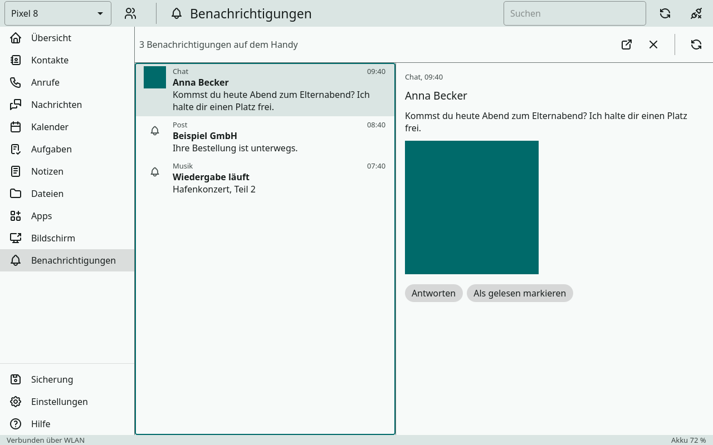

# Benachrichtigungen

Hier sehen Sie die Benachrichtigungen des Handys und schließen sie. Dazu gehören auch die Meldungen auf dem Desktop, der Abgleich der Zwischenablage, das Fenster für Anrufe und das Symbol im Benachrichtigungsbereich.

Die Benachrichtigungen kommen live vom Handy. QPhoneManager liest die Liste bei jeder Verbindung neu. Sie gehört nicht zum Abgleich.

## Das sehen Sie

Über der Liste steht, wie viele Benachrichtigungen das Handy zeigt. Jeder Eintrag nennt die App, die Uhrzeit, den Titel und den Text. Rechts stehen die Angaben der gewählten Benachrichtigung mit einem Bild, wenn es eines gibt, und die Aktionen, die die App anbietet, zum Beispiel **Antworten**.

Rechts über der Liste stehen drei Symbole:

| Symbol | Name | Wirkung |
|---|---|---|
| Pfeil aus einem Rahmen | **Auf dem Handy öffnen** | Öffnet die Benachrichtigung auf dem Handy |
| Kreuz | **Auf dem Handy schließen** | Schließt die Benachrichtigung auf dem Handy |
| Zwei Pfeile im Kreis | **Neu laden** | Liest die Liste noch einmal |

Mit Eingabe öffnen Sie die gewählte Benachrichtigung auf dem Handy, mit Entf schließen Sie sie dort.

Ein Knopf unter den Angaben führt eine Aktion der Benachrichtigung auf dem Handy aus. Danach meldet QPhoneManager **Auf dem Handy ausgeführt.** Das Symbol zum Schließen ist grau, wenn sich eine Benachrichtigung nicht schließen lässt, etwa weil das Handy sie dauerhaft zeigt. Behält das Handy eine Benachrichtigung trotzdem, bittet QPhoneManager Sie, sie am Handy zu schließen.

## Wenn die Liste leer bleibt

MyPhoneExplorer Client braucht auf dem Handy den Benachrichtigungszugriff. Fehlt er, zeigt der Bereich einen Hinweis.

1. Wählen Sie **Einstellung auf dem Handy zeigen**. Das Handy öffnet die Einstellung.
2. Erlauben Sie dort MyPhoneExplorer Client den Zugriff.
3. Wählen Sie in QPhoneManager **Neu laden**.

Meldet QPhoneManager, dass der Benachrichtigungszugriff nicht läuft, schalten Sie ihn auf dem Handy aus und wieder ein.

## Meldungen auf dem Desktop

Für jede neue Benachrichtigung des Handys zeigt QPhoneManager eine Meldung auf dem Desktop, solange das Handy verbunden ist. Die Meldung läuft über den Benachrichtigungsdienst Ihres Desktops. Sie hat diese Knöpfe:

- **Anzeigen:** Bringt QPhoneManager nach vorn und öffnet diesen Bereich.
- Die Aktionen der Benachrichtigung, zum Beispiel **Antworten**.
- **Auf dem Handy schließen:** Fehlt bei Benachrichtigungen, die das Handy dauerhaft zeigt.

Schließen Sie nur die Meldung auf dem Desktop, ändert sich auf dem Handy nichts.

Die Meldungen schalten Sie in den Einstellungen unter **Benachrichtigungen** mit **Neue Benachrichtigungen des Handys auf diesem Rechner zeigen** ein oder aus. Die Liste in diesem Bereich bleibt in beiden Fällen.

## Zwischenablage

In den Einstellungen unter **Benachrichtigungen** schaltet **Zwischenablage zwischen Handy und Rechner teilen** den Abgleich ein. Er ist ab Werk aus.

- Text, den Sie auf dem Rechner kopieren, geht an das Handy.
- Text, den Sie auf dem Handy kopieren, kommt nur an, solange MyPhoneExplorer Client dort geöffnet ist. Android gibt die Zwischenablage nur an die App im Vordergrund heraus.

## Anrufe

Bei einem Anruf auf dem Handy öffnet QPhoneManager ein kleines Fenster, das über den anderen Fenstern bleibt. Es zeigt den Namen aus Ihren Kontakten und die Nummer. Die Nummer fehlt manchmal, etwa wenn die App auf dem Handy die Anrufliste nicht lesen darf.

| Knopf | Wirkung |
|---|---|
| **Annehmen** | Nimmt den eingehenden Anruf an |
| **Ablehnen** | Lehnt den eingehenden Anruf ab |
| **Auflegen** | Beendet das Gespräch |
| **Stumm** | Schaltet das Mikrofon des Handys aus |
| **Lautsprecher** | Schaltet den Lautsprecher des Handys ein |

**Stumm** und **Lautsprecher** gehen, solange ein Gespräch läuft. QPhoneManager steuert nur den Anruf. Das Gespräch selbst führen Sie über das Handy. Klappt eine Aktion nicht, nennt die Meldung den Grund. Nutzen Sie dann das Handy selbst. Während QPhoneManager Daten mit dem Handy austauscht, kann ein Anruf unbemerkt bleiben.

## Symbol im Benachrichtigungsbereich

Bietet Ihr Desktop einen Benachrichtigungsbereich, zeigt QPhoneManager dort ein Symbol. Ein Klick darauf zeigt das Fenster. Das Menü des Symbols bietet:

- **Fenster zeigen**
- **Nachricht schreiben:** Öffnet eine neue Nachricht.
- **Trennen:** Beendet die Verbindung zum Handy.
- **Beenden:** Beendet QPhoneManager.

Schließen Sie das Hauptfenster, beendet sich QPhoneManager. Soll es nur mit dem Symbol starten, setzen Sie in den Einstellungen unter **Benachrichtigungen** das Häkchen bei **Im Benachrichtigungsbereich starten, ohne Fenster**. Das gilt ab dem nächsten Start. Hat der Desktop keinen Benachrichtigungsbereich, öffnet sich das Fenster trotzdem.
