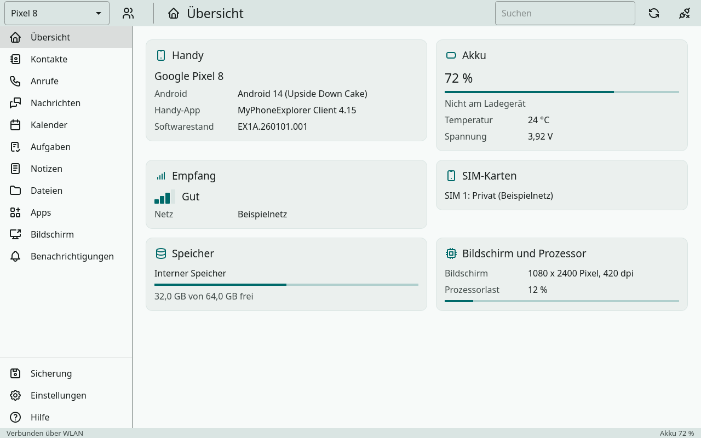

# Übersicht

Die Übersicht zeigt Modell, Akku, Empfang und Speicher des verbundenen Handys. Hier verwalten Sie auch die Handys, die QPhoneManager kennt.

## Das sehen Sie

Die Übersicht besteht aus Karten. Eine Angabe, die das Handy nicht liefert, steht als **Unbekannt** da.

| Karte | Inhalt |
|---|---|
| **Handy** | Modell, Android-Version, Version von MyPhoneExplorer Client (**Handy-App**) und **Softwarestand** des Handys |
| **Akku** | Ladestand in Prozent, ob das Handy lädt (**Lädt**) oder nicht (**Nicht am Ladegerät**), **Temperatur** und **Spannung** |
| **Empfang** | Stärke des Signals von **Kein Empfang** bis **Sehr gut** und das **Netz** des Anbieters |
| **SIM-Karten** | Jede SIM-Karte mit Steckplatz, Name und Anbieter |
| **Speicher** | Freier und gesamter Platz, getrennt nach **Interner Speicher** und **Speicherkarte** |
| **Bildschirm und Prozessor** | Auflösung und Dichte des Bildschirms und die **Prozessorlast** |

Akku, Empfang und Prozessorlast aktualisieren sich, solange das Handy sie meldet. Den Speicher fragt QPhoneManager nach einem Datenaustausch mit dem Handy neu ab, etwa nach einer Dateiübertragung.

Zeigt die Karte **SIM-Karten** den Hinweis, dass die App die SIM-Karten nicht lesen darf, erlauben Sie MyPhoneExplorer Client in den Android-Einstellungen den Zugriff auf das Telefon.

Ohne Verbindung zeigt die Seite stattdessen den Zustand: **Kein Handy verbunden**, **Verbindung unterbrochen** oder **Wartet auf die PIN**. Der Knopf **Verbinden** öffnet den Dialog zum Verbinden. Wie das geht, steht unter [Erste Schritte](getting-started.md).

## Mehrere Handys

QPhoneManager legt für jedes Handy ein eigenes Profil an, sobald es das erste Mal verbunden war. Es erkennt das Handy an der Kennung der App. Jedes Profil hat seinen eigenen Namen, seine eigenen Daten und auf Wunsch seine eigene gemerkte PIN.

So sehen Sie die Daten eines Handys ohne Verbindung:

1. Öffnen Sie links in der Kopfzeile das Feld **Handy**.
2. Wählen Sie das Handy.

QPhoneManager zeigt dann die Daten vom letzten Abgleich. Sie lassen sich lesen, aber nicht ändern.

So benennen Sie ein Handy um oder entfernen es:

1. Wählen Sie in der Kopfzeile **Handys verwalten**. Der Dialog **Handys auf diesem Rechner** öffnet sich.
2. Wählen Sie **Umbenennen**, geben Sie unter **Neuer Name** 1 bis 64 Zeichen ein und bestätigen Sie mit **Umbenennen**.
3. Oder wählen Sie **Entfernen** und bestätigen Sie die Frage mit **Entfernen**.

Mit **Anzeigen** wechseln Sie zu einem anderen Handy in der Liste. Das Handy, das gerade angezeigt wird, trägt den Zusatz **wird angezeigt**.

**Entfernen** löscht die gespeicherten Daten und die gemerkte PIN dieses Handys auf diesem Rechner. Auf dem Handy ändert sich nichts.
