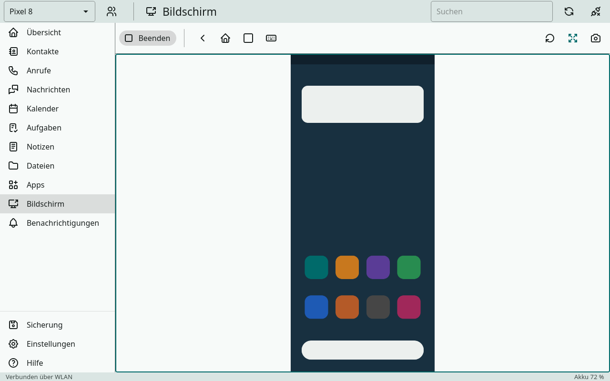

# Bildschirm

Hier sehen Sie den Bildschirm des Handys und bedienen es mit Maus und Tastatur.

Die Spiegelung geht nur über WLAN oder USB, nicht über Bluetooth. Sie braucht auf dem Handy Android 5 oder neuer. Das Bedienen braucht Android 7 oder neuer.

## Bildschirm anzeigen

1. Wählen Sie **Bildschirm** in der Seitenleiste.
2. Wählen Sie **Bildschirm zeigen**. QPhoneManager fragt das Handy nach seinem Bildschirm.
3. Bestätigen Sie auf dem Handy, dass es seinen Bildschirm teilen darf. Wählen Sie dort den ganzen Bildschirm.

Das Handy fragt bei jedem Start der Spiegelung neu. Bestätigen Sie nicht rechtzeitig, bricht die Spiegelung ab. Starten Sie sie dann noch einmal.

Der Bildschirm erscheint im Fenster und aktualisiert sich laufend. **Beenden** stoppt die Spiegelung. Der Rechner zeigt alles, was auf dem Handy auf dem Bildschirm steht, auch Nachrichten und Benachrichtigungen.

## Das Handy bedienen

Das Bedienen braucht auf dem Handy die Bedienungshilfe von MyPhoneExplorer Client. Ist sie aus, zeigt QPhoneManager einen Hinweis über dem Bild. So schalten Sie sie ein:

1. Wählen Sie **Einstellung auf dem Handy öffnen**. Das Handy zeigt, wie Sie die Bedienungshilfe einschalten.
2. Schalten Sie sie auf dem Handy ein.
3. Wählen Sie in QPhoneManager **Erneut prüfen**.

Danach gilt:

- **Klicken** tippt auf die Stelle.
- **Ziehen** wischt.
- **Rechtsklick** drückt lange.
- Das **Mausrad** scrollt.

In der Werkzeugleiste stehen diese Symbole:

| Symbol | Name | Wirkung |
|---|---|---|
| Pfeil nach links | **Zurück** | Drückt die Zurück-Taste des Handys |
| Haus | **Startbildschirm** | Geht zum Startbildschirm |
| Quadrat | **Zuletzt verwendete Apps** | Öffnet die Übersicht der letzten Apps |
| Tastatur | **Auf dem Handy tippen** | Schickt Text, den Sie tippen, an das Handy |
| Pfeil im Kreis | **Bild drehen** | Dreht das Bild um 90 Grad |
| Vier Pfeile | **In das Fenster einpassen** | Passt das Bild an. Ausgeschaltet erscheint der Bildschirm in voller Größe |
| Kamera | **Bildschirmfoto speichern** | Speichert das aktuelle Bild als PNG-Datei |

Die ersten vier Symbole sind erst aktiv, wenn die Steuerung geht. **Bild drehen**, **In das Fenster einpassen** und **Bildschirmfoto speichern** gehen, sobald ein Bild da ist.

### Text eingeben

1. Wählen Sie **Auf dem Handy tippen**. Der Fokus springt auf das Bild.
2. Tippen Sie den Text mit der Tastatur des Rechners. Er geht an das Handy.
3. Drücken Sie Tab, um das Bild zu verlassen.

## Bildschirmfoto speichern

1. Wählen Sie **Bildschirmfoto speichern**.
2. Wählen Sie im Dateidialog Ort und Namen. Die Datei ist ein PNG-Bild.

## Wenn es nicht klappt

- **Das Handy teilt den Bildschirm nicht:** Starten Sie neu und erlauben Sie es auf dem Handy. Bestätigen Sie schneller, wenn die Meldung sagt, dass niemand rechtzeitig bestätigt hat.
- **Das Handy nimmt keine Eingaben an:** Schalten Sie die Bedienungshilfe ein, wie oben beschrieben. Auf Handys mit Android 5 und 6 gibt es keine Eingabe von hier.
- **Das Bild bricht ab:** Starten Sie die Spiegelung noch einmal.
