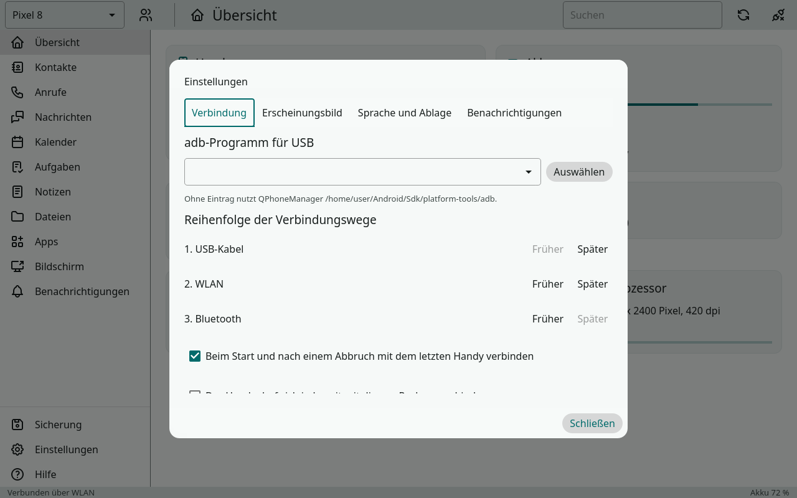
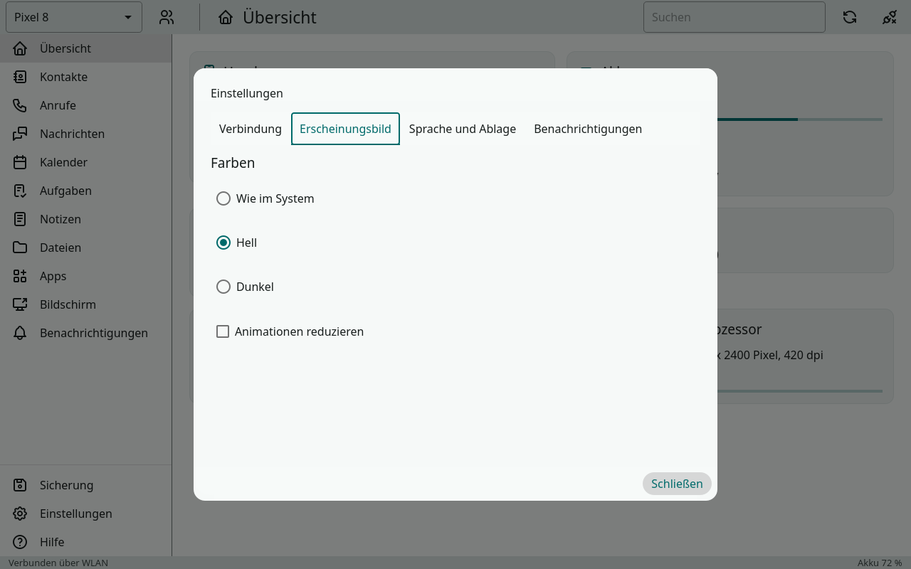
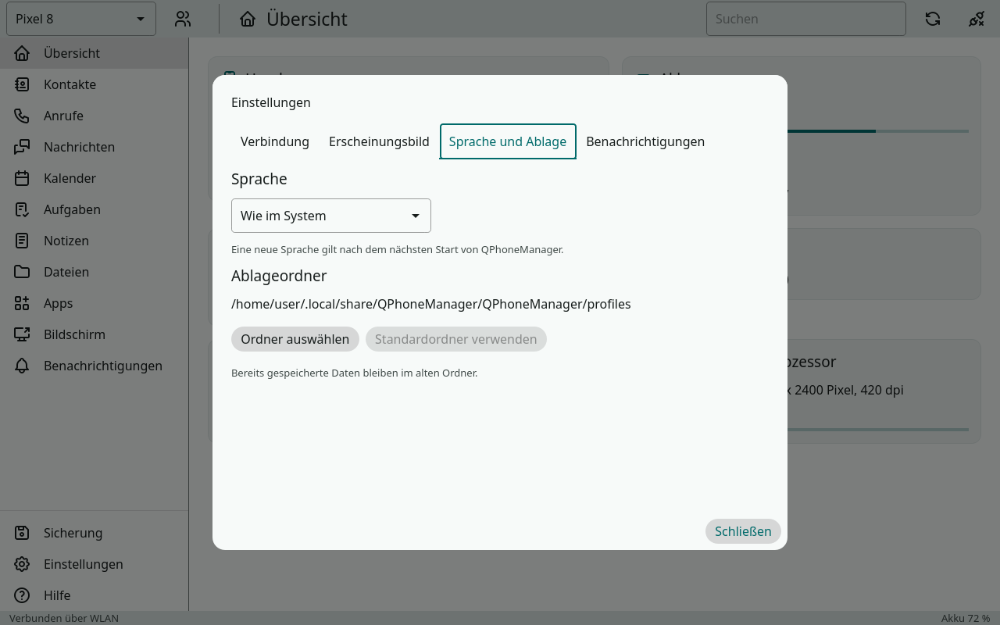
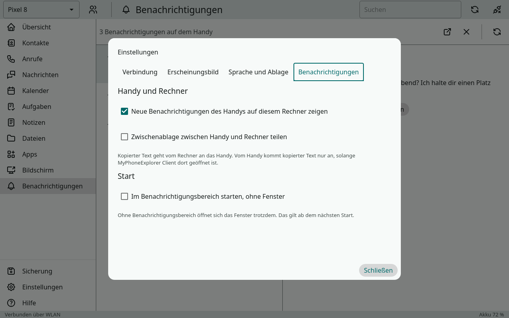

# Einstellungen

Hier legen Sie fest, wie das Programm verbindet, wie es aussieht und wo es Daten speichert.

Den Dialog öffnen Sie mit **Einstellungen** in der Seitenleiste oder mit Strg+, (Strg und Komma). Er hat vier Reiter. Jede Änderung gilt sofort, außer wo es anders steht. **Schließen** beendet den Dialog. F1 schließt ihn und öffnet dieses Kapitel.

## Verbindung

- **adb-Programm für USB:** Das Programm adb stellt die Verbindung über das USB-Kabel her. Lassen Sie das Feld leer, nutzt QPhoneManager das adb, das es selbst findet. Der Hinweis unter dem Feld nennt den Pfad. Mit **Auswählen** wählen Sie ein anderes adb. Fehlt adb auf dem Rechner, installieren Sie die Android Platform Tools und wählen Sie adb hier aus.
- **Reihenfolge der Verbindungswege:** Ab Werk gilt USB-Kabel, WLAN, Bluetooth. Mit **Früher** und **Später** verschieben Sie einen Weg. Beim Start probiert QPhoneManager die Wege in dieser Reihenfolge, und nur die, über die das Handy schon einmal verbunden war.
- **Beim Start und nach einem Abbruch mit dem letzten Handy verbinden:** Ab Werk an. Ist es aus, verbinden Sie immer von Hand.
- **Das Handy darf sich jederzeit mit diesem Rechner verbinden:** Ab Werk aus. Dann wartet der Rechner nur auf das Handy, solange das Fenster mit dem QR-Code offen ist. Ist es an, wartet er dauernd. Die Statuszeile zeigt dann **Wartet auf das Handy**. Belegt ein anderes Programm den dafür nötigen Port, meldet QPhoneManager das.

WLAN-Verbindungen sind nicht verschlüsselt. Nutzen Sie sie nur in einem Netz, dem Sie vertrauen, oder verbinden Sie über USB.

## Erscheinungsbild

- **Farben:** **Wie im System**, **Hell** oder **Dunkel**. Ab Werk folgt QPhoneManager dem System.
- **Animationen reduzieren:** Dialoge, Menüs, Auswahllisten, Tooltips und das Bearbeitungsmenü von Textfeldern öffnen und schließen sich ohne Übergang. Die Markierung der Reiter springt zum gewählten Reiter. Kleine Animationen des Stils bleiben, etwa bei Häkchen, Klickeffekten und dem Ausblenden der Bildlaufleisten. Ab Werk aus.

## Sprache und Ablage

- **Sprache:** **Wie im System**, **Deutsch** oder **English**. Das Feld zeigt die gewählte Sprache. Eine neue Sprache gilt nach dem nächsten Start von QPhoneManager.
- **Ablageordner:** Hier speichert QPhoneManager die Daten Ihrer Handys. Der Dialog zeigt den Ordner. Ab Werk ist das der Ordner profiles unter .local/share/QPhoneManager/QPhoneManager im Home-Verzeichnis. **Ordner auswählen** wählt einen anderen. **Standardordner verwenden** geht zurück zum Standard.

Bereits gespeicherte Daten bleiben im alten Ordner. Nach einem Wechsel zeigt QPhoneManager nur die Handys, deren Daten im neuen Ordner liegen. Ein Ordner, in den QPhoneManager nicht schreiben kann, führt zu einer Meldung.

## Benachrichtigungen

- **Neue Benachrichtigungen des Handys auf diesem Rechner zeigen:** Ab Werk an. Es schaltet nur die Meldungen auf dem Desktop. Die Liste im Bereich [Benachrichtigungen](notifications.md) bleibt.
- **Zwischenablage zwischen Handy und Rechner teilen:** Ab Werk aus. Text, den Sie auf dem Rechner kopieren, geht an das Handy. Text vom Handy kommt nur an, solange MyPhoneExplorer Client dort geöffnet ist.
- **Im Benachrichtigungsbereich starten, ohne Fenster:** Ab Werk aus. Ohne Benachrichtigungsbereich öffnet sich das Fenster trotzdem. Das gilt ab dem nächsten Start.

Die Feiertage für den Kalender wählen Sie im Bereich [Kalender](calendar.md), nicht hier.
