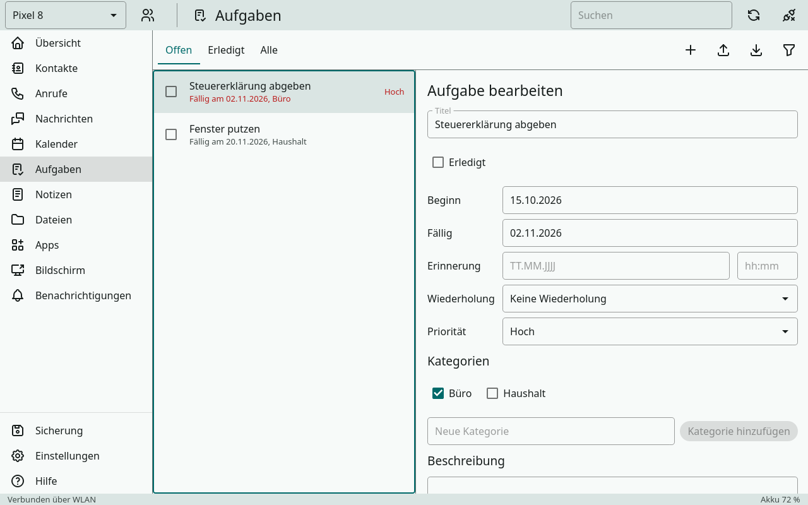

# Aufgaben

Hier verwalten Sie die Aufgaben des Handys und haken erledigte ab.

Die Aufgaben erscheinen, nachdem Sie einmal mit **Abgleichen** geladen haben. Der Abgleich holt Aufgaben und Termine zusammen. Ohne Verbindung sehen Sie den Stand vom letzten Abgleich.

## Das sehen Sie

Die Reiter **Offen**, **Erledigt** und **Alle** filtern die Liste. Jeder Eintrag zeigt den Titel, vor ihm ein Kästchen zum Abhaken, darunter das Fälligkeitsdatum und die Kategorien. Überfällige Aufgaben zeigt QPhoneManager rot. Eine hohe Priorität steht rot am Rand.

Rechts neben den Reitern stehen vier Symbole:

| Symbol | Name | Wirkung |
|---|---|---|
| Plus | **Neue Aufgabe** | Legt eine Aufgabe an |
| Pfeil nach oben | **Aufgaben importieren** | Liest eine iCalendar-Datei ein |
| Pfeil nach unten | **Aufgaben exportieren** | Schreibt die Aufgaben in eine iCalendar-Datei |
| Trichter | **Kategorien für Aufgaben** | Öffnet die Verwaltung der Kategorien |

Das Suchfeld in der Kopfzeile sucht in Titel, Beschreibung und Kategorien.

## Aufgabe anlegen

1. Wählen Sie **Neue Aufgabe** oder drücken Sie Strg+N. Rechts öffnet sich das Formular.
2. Geben Sie den **Titel** ein.
3. Geben Sie bei Bedarf **Beginn** und **Fällig** ein. Das Datum geben Sie im Datumsformat Ihres Systems ein. Der Beginn darf nicht nach der Fälligkeit liegen.
4. Geben Sie bei Bedarf eine **Erinnerung** mit Datum und Uhrzeit ein. Tragen Sie beides ein oder keines von beiden.
5. Wählen Sie bei Bedarf **Wiederholung** und **Priorität** (**Hoch**, **Normal** oder **Niedrig**).
6. Setzen Sie bei **Kategorien** Häkchen, oder legen Sie unter **Neue Kategorie** eine an und wählen Sie **Kategorie hinzufügen**.
7. Schreiben Sie bei Bedarf eine **Beschreibung**.
8. Wählen Sie **Speichern**.

Eine neue Aufgabe geht beim Speichern sofort an das Handy.

## Aufgabe abhaken

Setzen Sie das Häkchen im Kästchen vor der Aufgabe oder wählen Sie die Aufgabe und drücken Sie die Leertaste. Im Formular gibt es dafür das Feld **Erledigt**. Erledigte Aufgaben zeigt der Reiter **Erledigt**.

## Aufgabe ändern oder löschen

1. Wählen Sie die Aufgabe in der Liste.
2. Ändern Sie die Felder und wählen Sie **Speichern**, oder wählen Sie **Löschen**. In der Liste löscht auch Entf.
3. Bestätigen Sie beim Löschen die Frage mit **Löschen**.

Hat sich die Aufgabe auf dem Handy geändert, seit QPhoneManager sie geladen hat, öffnet sich der Dialog **Die Aufgabe wurde auf dem Handy geändert**. Wählen Sie **Meine Fassung speichern**, **Fassung des Handys behalten** oder **Weiter bearbeiten**.

## Kategorien verwalten

1. Wählen Sie **Kategorien für Aufgaben**.
2. Für eine neue Kategorie geben Sie unter **Name** einen Namen ein, wählen eine **Farbe** und dann **Hinzufügen**.
3. Für eine vorhandene Kategorie wählen Sie sie in der Liste. Dann ändern Sie Name oder Farbe und wählen **Ändern**, oder Sie wählen **Löschen**.

Kategorien lassen sich nur bei stehender Verbindung ändern.

## Importieren und exportieren

- **Aufgaben importieren** liest Dateien im Format iCalendar (.ics, .ical, .vcs). Aufgaben ohne Titel lässt QPhoneManager aus und nennt die Zahl.
- **Aufgaben exportieren** schreibt die Aufgaben in eine iCalendar-Datei (.ics).
