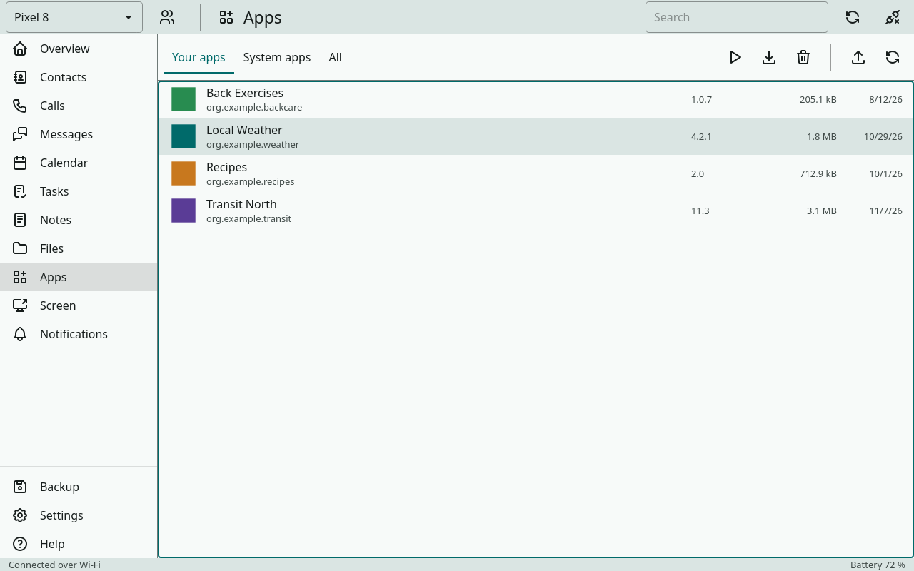

# Apps

Here you see the apps of the phone, back them up and install new ones.

QPhoneManager asks the phone for the apps when you open the area. They are not part of the sync. Without a connection the area shows no apps.

## What you see

Each row shows the icon of the app, its name and package, the version, the size and the installation date. The tabs **Your apps**, **System apps** and **All** filter the list. The search field in the header searches names and packages.

To the right of the tabs are five icons:

| Icon | Name | Effect |
|---|---|---|
| Triangle | **Open on the phone** | Starts the chosen app on the phone |
| Arrow down | **Save the APK on this computer** | Copies the installation file of the app to the computer |
| Wastebasket | **Remove from the phone** | Removes the app |
| Arrow up | **Install an APK from this computer** | Installs an app from an APK file |
| Two arrows in a circle | **Load the apps again** | Reads the list once more |

The menu that a right click or the menu key opens offers the same actions.

## Open an app

Choose the app and then **Open on the phone**, or press Enter. The app starts on the phone. If it has no window of its own, QPhoneManager says that the phone cannot open it.

## Save an APK

1. Choose the app.
2. Choose **Save the APK on this computer**.
3. In the file dialog, choose the place and name.

A bar below the list shows the progress and lets you stop with **Cancel**. Saving works only over Wi-Fi or USB.

## Install an app

1. Choose **Install an APK from this computer**.
2. In the file dialog, choose an APK file (.apk).
3. Confirm the question on the phone.

QPhoneManager sends the file to the phone. The installation starts only when you agree on the phone. Installing also works only over Wi-Fi or USB. QPhoneManager rejects an empty or unreadable file.

## Remove an app

1. Choose the app and then **Remove from the phone**, or press Delete.
2. Confirm the question **Remove name?** with **Remove**.
3. Confirm the question on the phone.

The phone then deletes the app and its data. Without your agreement on the phone, the app stays.
