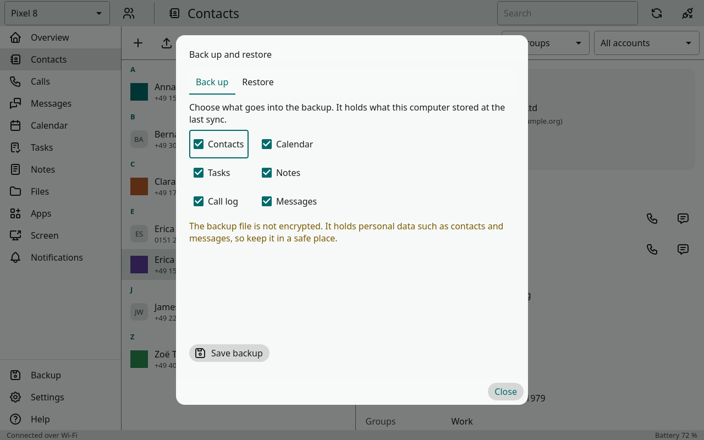
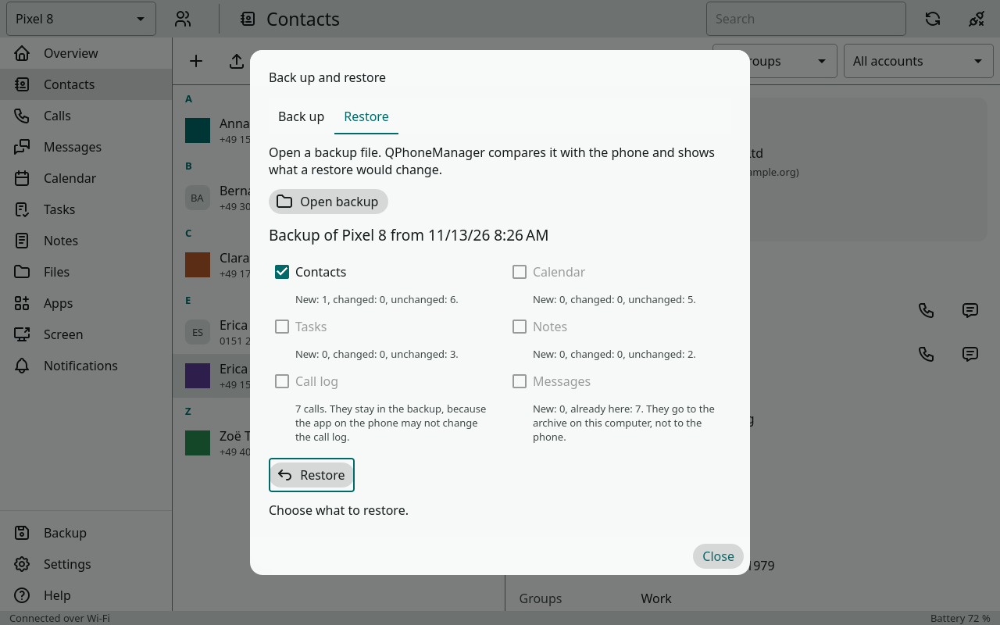

# Back up and restore

A backup saves contacts, calendar, tasks, notes, the call log and messages in one file. From this file you get the data back later.

You open the dialog with **Backup** in the sidebar. It has the tabs **Back up** and **Restore**.

## Back up

The backup holds what QPhoneManager stored at the last sync. Sync the phone first. The phone does not have to be connected to back up. A phone must be chosen.

1. Choose **Backup** in the sidebar.
2. In the tab **Back up**, tick the parts that should go into the backup: **Contacts**, **Calendar**, **Tasks**, **Notes**, **Call log** and **Messages**. All are ticked by default.
3. Choose **Save backup**.
4. In the file dialog, choose the place and name. QPhoneManager suggests a name with the phone and the date.

The file has the extension .qpmbackup. It is a ZIP archive. It holds contacts as vCard, appointments and tasks as iCalendar, notes as vNote, the call log as a CSV table and the messages as XML. A zip program opens it, and you can read your data without QPhoneManager.

The backup file is not encrypted. It holds personal data such as contacts and messages. Keep it in a safe place.

While QPhoneManager saves, the dialog shows the progress. **Stop** ends the saving. No backup is left behind then.

## Restore

1. Choose **Backup** in the sidebar and the tab **Restore**.
2. Choose **Open backup** and, in the file dialog, a file with the extension .qpmbackup.
3. Read the preview. It names for each part what would change.
4. Tick the parts that you want back.
5. Choose **Restore**.

Contacts, calendar, tasks and notes go back to the phone. Connect the phone before step 5 and keep it connected until the message **The restore is done.** appears. Only messages can also be restored without a connection.

### Read the preview

For each part it says what the backup holds compared with the phone:

- **New:** The entry is missing on the phone. QPhoneManager creates it there.
- **Changed:** The entry exists on the phone, but with other content. The restore overwrites the entry on the phone with the one from the backup.
- **Unchanged:** The phone already has the entry with the same content. A second restore therefore creates nothing twice.

A part can be chosen only if it holds new or changed entries. If the phone is not connected, QPhoneManager compares the backup with the data on this computer and says so. Contacts, calendar, tasks and notes cannot be chosen then. Connect the phone to restore them.

Two parts are different:

- **Messages:** They go only into the archive on this computer, not onto the phone. The app on the phone does not take messages. The preview says how many are new and how many are there already.
- **Call log:** It stays in the backup. It cannot be restored because the app on the phone may not change the call log.

### A backup from another phone

If the backup comes from another phone, the preview says so. The restore then only adds what the phone lacks. Existing entries stay unchanged, even if they differ in the backup.

### What applies to single parts

- **Contacts:** New contacts in an account that the phone does not have land in the default account of the phone. For new contacts, a photo over 200 KB is dropped. For changed contacts, the photo of the phone stays.
- **Calendar:** Appointments from a calendar that is read-only on the phone are not restored. The preview shows how many. Appointments without a calendar, or from a calendar the phone does not have, go to the default calendar that the phone may write to.

### Stop and result

**Stop** ends the restore. What was written back until then stays.

Afterwards the dialog names for each part how many entries came back and how many did not. For failures, the list gives the reason. With many entries, the restore takes longer.

## If it does not work

- **The file is not a QPhoneManager backup or is damaged:** Choose another file.
- **The backup comes from a newer version:** Update QPhoneManager and open the file again.
- **The backup is too large for one file:** Choose fewer parts when you back up.
- **The phone did not take an entry:** Check it on the phone.
