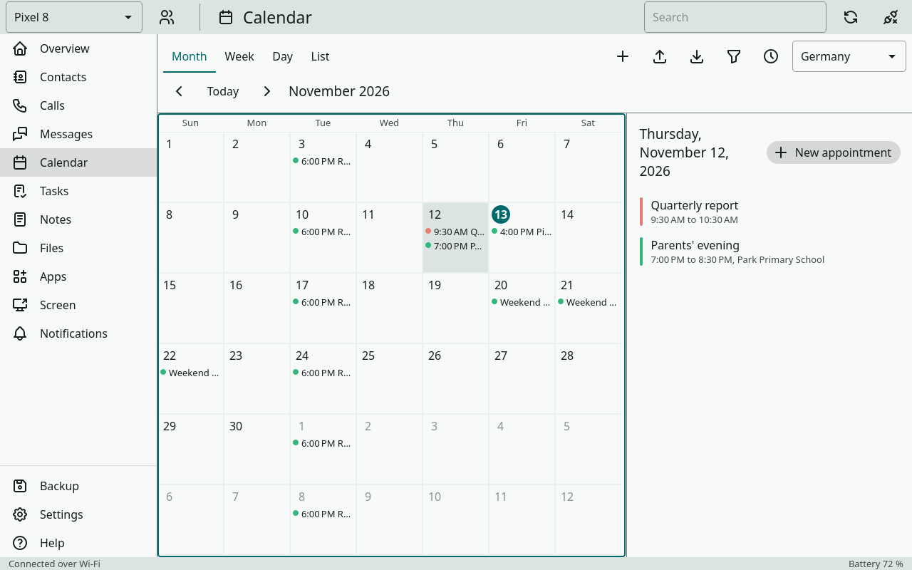
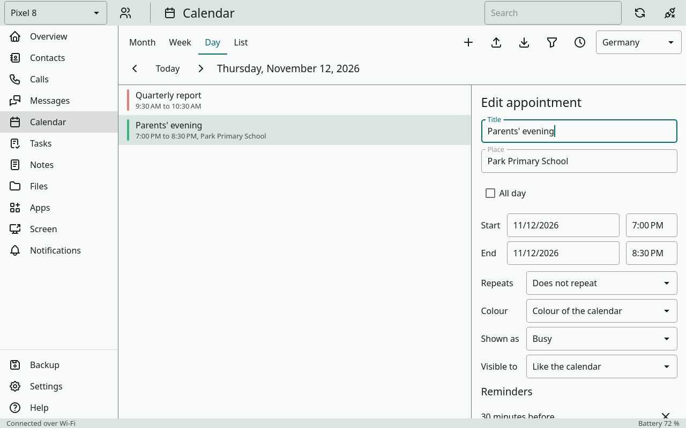

# Calendar

The calendar shows the appointments of the phone by month, week, day or as a list. You create, change and delete appointments.

The appointments appear after you have loaded them once with **Sync**. The sync fetches appointments and tasks together. Without a connection you see the state of the last sync.

## What you see

Above the calendar, the tabs **Month**, **Week**, **Day** and **List** are on the left. To their right are these icons and a field:

| Icon | Name | Effect |
|---|---|---|
| Plus | **New appointment** | Creates an appointment |
| Arrow up | **Import appointments and tasks** | Reads an iCalendar file |
| Arrow down | **Export appointments and tasks** | Writes appointments and tasks into an iCalendar file |
| Funnel | **Choose calendars** | Chooses the calendars that QPhoneManager shows and syncs |
| Clock | **Alarms** | Opens the alarms of the phone |
| Field **Show public holidays of** | | Shows public holidays |

Below, **Earlier** and **Later** (arrows) move the time, and **Today** jumps to the current day. The middle shows the period.

- **Month and Week:** On the left is a grid with the appointments of each day, on the right the appointments of the chosen day. The week shows the calendar week.
- **Day:** The appointments of the day are a list.
- **List:** All appointments of the month are listed one below the other.

A coloured bar or dot shows the colour of the appointment. In the grid, the arrow keys left and right move by one day, up and down by one week. Page Up and Page Down change the period. Enter opens the day.

The search field in the header searches the title and place of appointments.

## Create an appointment

1. Choose **New appointment**, **New appointment** next to the day on the right, or press Ctrl+N.
2. Enter the **Title** and, if needed, the **Place**.
3. Enter **Start** and **End**. For an appointment lasting all day, tick **All day**.
4. Under **Calendar**, choose the calendar. Only calendars the phone may write to are listed.
5. If needed, choose **Repeats**, **Colour**, **Shown as** and **Visible to**.
6. If needed, add reminders.
7. Choose **Save**.

You enter the date in the date format of your system. The empty field shows the pattern. If the title or start is missing, or the end lies before the start, QPhoneManager says so when you save.

**Repeats** offers **Does not repeat**, **Every day**, **Every week**, **Every month** and **Every year**. A rule that was created on the phone with more options shows in QPhoneManager as **Repeats by a rule of its own**.

**Reminders:** Choose a time, from **At the start** to **7 days before**, and then **Add reminder**. The cross next to a reminder removes it.

A new appointment goes to the phone as soon as you save it.

## Change or delete an appointment

1. Choose the appointment in the list.
2. Choose **Edit** and change it, or choose **Delete**.
3. When deleting, confirm the question with **Delete**.

**Back to the day** closes the details of the appointment. Appointments in a calendar that the phone may not write to can only be read.

For a repeating appointment there are two ways:

- **Leave out this time** removes only the chosen day from the series. In the form, QPhoneManager shows how many times an appointment is left out and offers **Bring back**.
- **Delete the series** deletes the appointment with all repeats on the phone and on this computer.

If an appointment has changed on the phone since QPhoneManager loaded it, the dialog **The appointment was changed on the phone** opens. Choose **Save my version**, **Keep the phone's version** or **Back to editing**.

## Choose calendars

A phone often has several calendars, for example one per account.

1. Choose **Choose calendars**. The dialog **Calendars on the phone** opens.
2. Tick each calendar that QPhoneManager should show and sync. The space bar adds the chosen calendar or takes it out.
3. Under **For new**, choose the calendar that new appointments go to. Enter makes the chosen calendar that one.
4. Choose **Apply**.

Under the name of a calendar is its account. For a calendar that the phone may not write to, **read only** follows it. It takes no new appointments. You can change the choice only while the connection is up. The phone then syncs the chosen calendars.

## Import and export

- **Import appointments and tasks** reads files in the iCalendar format (.ics, .ical, .ifb, .vcs). It needs a calendar that the phone may write to. QPhoneManager leaves out entries without a title or start and gives the number.
- **Export appointments and tasks** writes an iCalendar file (.ics).

## Public holidays

In the field **Show public holidays of**, choose **No holidays**, **Germany**, **Austria** or **Switzerland**. QPhoneManager shows the holidays in the grid and in the list. The choice stays saved.

Only holidays that apply in the whole country appear. Holidays of single states, cantons or regions are missing.

## Alarms

**Alarms** opens the dialog **Alarms on the phone** with the list of alarms. Each alarm shows the time, name, weekdays and **On** or **Off**.

- **Change an alarm:** Choose an alarm, change **Time**, **Name**, the weekdays or **Alarm is on**, and choose **Save**.
- **New alarm:** Choose **Start new alarm**, fill in the fields and choose **Save**.

Not every phone lets the app reach its alarms. The dialog then says **Not supported** and advises you to set the alarms on the phone itself. You cannot delete alarms here.
