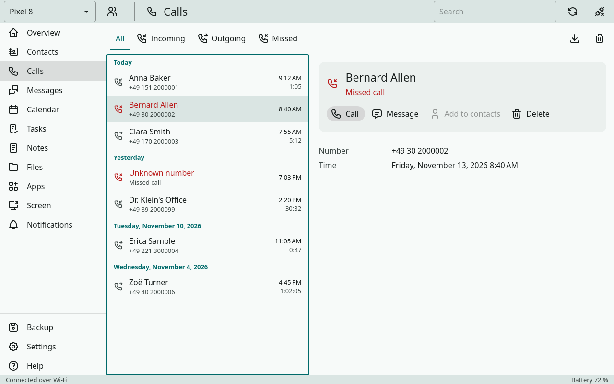

# Calls

The call log shows incoming, outgoing and missed calls with the names from your contacts.

The calls appear after you have loaded them once with **Sync**. Without a connection you see the list of the last sync.

## What you see

The list is divided by day. Each entry shows the name or number, the kind of call, the time and, for calls that took place, the duration. Missed calls are red. A call without a number is called **Unknown number**.

The tabs above the list filter by **All**, **Incoming**, **Outgoing** and **Missed**. The search field in the header searches names and numbers.

On the right are the details of the chosen call: **Number**, **Time**, **Duration** and, with several SIM cards, the **SIM card**. If the number is hidden, **Hidden** appears there.

At the far right above the list are two icons:

| Icon | Name | Effect |
|---|---|---|
| Arrow down | **Export the calls in the list** | Writes the calls shown into a table (.csv) |
| Wastebasket | **Delete the calls in the list** | Deletes all calls shown |

## Call back and write

Choose a call. These buttons are then available:

- **Call:** The phone calls the number. You hold the conversation on the phone. The button works only while the connection is up.
- **Message:** Opens a new message to the number in the area [Messages](messages.md).
- **Add to contacts:** Opens a form with the number and name in the area [Contacts](contacts.md). The button is grey if the number already has a contact.

## Delete calls

1. Choose the call and press Delete, or choose **Delete**. For all calls shown, choose **Delete the calls in the list**.
2. Confirm the question with **Delete**.

The call log on the phone cannot be changed with MyPhoneExplorer Client 4.15. The app lacks the permission for it. If the app refuses to delete, the calls stay on the phone and in the list. QPhoneManager reports this and asks you to delete the call on the phone itself.

## Export

1. If you like, choose a tab and enter a search text. The export holds only the calls shown.
2. Choose **Export the calls in the list**.
3. In the file dialog, choose the place and name of the table.
