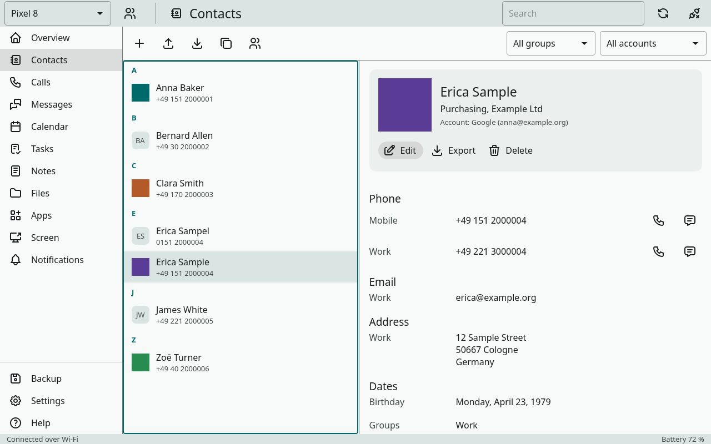
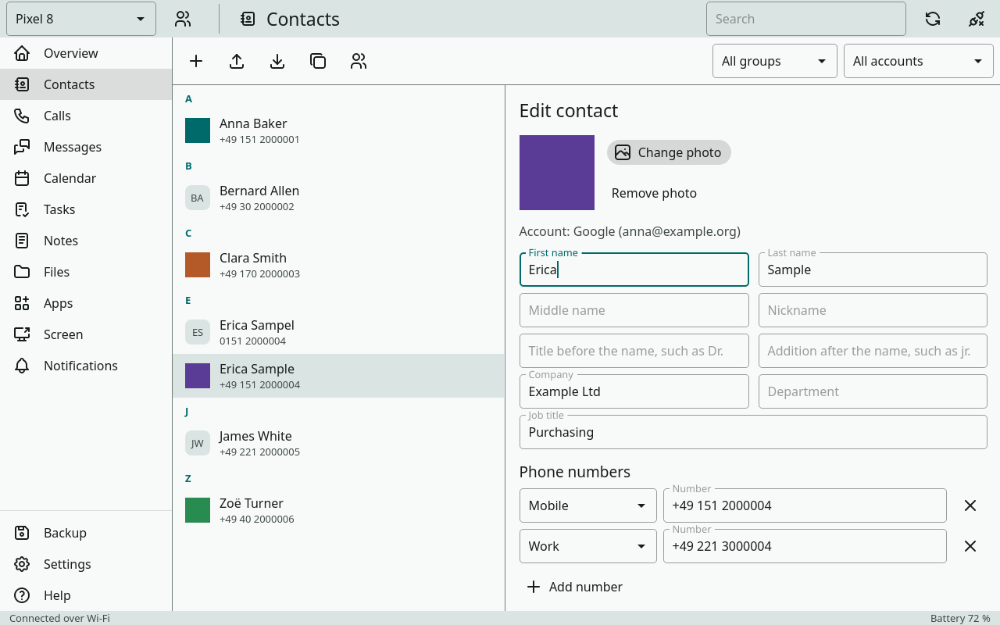

# Contacts

Here you see and edit the contacts of the phone. Each change goes to the phone as soon as you save it.

The contacts appear after you have loaded them once with **Sync**. Later syncs fetch only what has changed.

## What you see

On the left is the list, ordered by first letter, with a photo or initials and the first number. On the right are the details of the chosen contact: numbers, mail addresses, addresses, websites, messengers, dates, groups and note. Next to each number there is an icon to call it and one to write a message.

Above the list is the toolbar:

| Icon | Name | Effect |
|---|---|---|
| Plus | **New contact** | Creates a contact |
| Arrow up | **Import contacts** | Reads a file with contacts |
| Arrow down | **Export the contacts in the list** | Writes the contacts of the list into a file |
| Two squares | **Find duplicates** | Opens the search for duplicates |
| Two people | **Account for new contacts** | Chooses the account that new contacts go to |

At the far right, the fields **All groups** and **All accounts** filter the list. The field for accounts appears only if the phone has more than one account. **Account for new contacts** can be chosen only then.

## Find contacts

Type into the search field at the top. The list shows the contacts whose name, nickname, company or a mail address contains the text. A number is found from three digits on. Case and accents do not count: Müller and muller match the same contact.

## Create a contact

1. Choose **New contact** or press Ctrl+N. The form opens on the right.
2. If the phone has several accounts, choose the account under **Save in account**.
3. Fill in the fields. A name, a number, a mail address or a company is enough.
4. Choose **Save**.

The form has these parts:

- **Photo:** **Change photo** opens a file dialog. Afterwards you choose the part of the picture. **Remove photo** deletes the photo.
- **Name:** First name, last name, middle name, nickname, title before the name and addition after the name.
- **Company, Department, Job title**
- **Phone numbers, Mail addresses, Addresses, Websites, Messengers:** Each entry has a type, for example Mobile, Home or Work, or an **Own name**. Buttons such as **Add number** or **Add mail address** add rows. The cross next to a row removes it.
- **Dates:** Birthday, anniversary and other dates. The field shows an example in the date format of your system.
- **Groups:** Tick the groups of the phone, or create a new one under **New group**.
- **Note**

The phone takes up to 20 entries of each kind and a small photo. If a photo is too large, choose another one or a larger part of it.

## Change a contact

1. Choose the contact in the list.
2. Choose **Edit**.
3. Change the fields and choose **Save**.

Only the entries you changed go to the phone. All others stay as they are there. The account of a contact cannot be changed.

If the contact has changed on the phone since QPhoneManager loaded it, the dialog **The contact was changed on the phone** opens. It shows both versions side by side. Then choose:

- **Save my version** to overwrite the version on the phone.
- **Keep the phone's version** to discard your changes.
- **Back to editing** to return to the form.

## Delete a contact

1. Choose the contact and press Delete, or choose **Delete** in the details of the contact.
2. Confirm the question with **Delete**.

QPhoneManager deletes the contact on the phone and on this computer.

## Call and write

- The handset icon next to a number lets the phone call that number. You hold the conversation on the phone.
- The speech bubble icon opens a new message to that number in the area [Messages](messages.md).

## Duplicate contacts

1. Choose **Find duplicates**.
2. The dialog names pairs with the same phone number, the same mail address or a similar name.
3. For each pair, choose **Merge** or **Ignore**.

Merging keeps the first contact. It gains what only the second one has. The second one is deleted on the phone.

## Import and export

- **Import:** Choose **Import contacts** and a file in the vCard format (.vcf) or a table saved as CSV. QPhoneManager reads vCard versions 2.1, 3.0 and 4.0. The contacts land on the phone. Contacts that the phone does not accept are left out, and QPhoneManager gives the number.
- **Export:** **Export the contacts in the list** writes all contacts that the list shows, with search and filter applied. In the details of a contact, **Export** writes only that contact. You choose vCard (.vcf, version 3.0) or table (.csv).

## Notes

- Without a connection you see the contacts of the last sync, but you change nothing.
- QPhoneManager writes a table so that cells that begin like a formula do not run as a formula in the spreadsheet.
