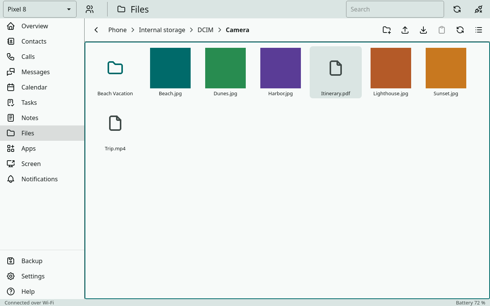
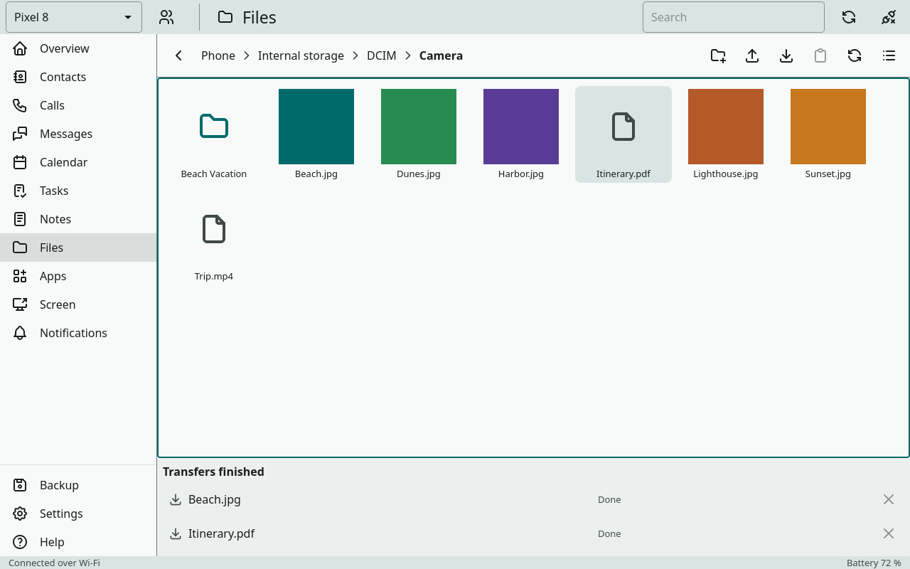

# Files

Here you copy files between the phone and this computer and create folders. You also rename, move and delete files.

The files come live from the phone. QPhoneManager asks for them as soon as you open the area. Copying, thumbnails and opening files work only over Wi-Fi or USB, not over Bluetooth.

For the app to see your files, it needs access to all files in Android. If it is missing, QPhoneManager says so. Then allow it for MyPhoneExplorer Client in the Android settings.

## What you see

The top level is called **Phone**. It shows the storages that the phone reports, for example **Internal storage**, **Memory card**, **Phone storage** or **Second profile**. Below it, you open folders as in a file manager. The path bar shows where you are. A click on a part of the path jumps there.

The view is a grid with thumbnails for pictures, or a list with size and modification time. **Show as a list** and **Show as a grid** switch between the two.

The toolbar holds, from left to right:

| Icon | Name | Effect |
|---|---|---|
| Arrow left | **Up to the folder above** | Goes up one level |
| Folder with plus | **New folder** | Creates a folder in the open folder |
| Arrow up | **Copy files from this computer** | Opens a menu with **Copy files** and **Copy a folder** |
| Arrow down | **Save on this computer** | Copies the chosen entry to this computer |
| Clipboard | **Paste here** | Pastes cut entries into the open folder |
| Two arrows in a circle | **Load the folder again** | Reads the folder once more |
| List or grid | **Show as a list** or **Show as a grid** | Switches the view |

The search in the header is not active here.

## Copy files from the phone to the computer

1. Open the folder with the file.
2. Choose the file or folder.
3. Choose **Save on this computer**, or open the menu with a right click and choose **Save on this computer**.
4. In the file dialog, choose the folder on the computer.

You can also drag a file from the grid or the list into your file manager. This works for files, not for folders.

## Copy files from the computer to the phone

1. Open the target folder on the phone. On the top level **Phone**, nothing can be copied.
2. Choose **Copy files from this computer** and then **Copy files** or **Copy a folder**.
3. In the file dialog, choose the files or the folder.

You can also drag files and folders from your file manager into the file view. They land in the open folder.

The list of transfers appears at the bottom. Each row shows the state: **Waiting**, **Reading the folder**, the progress in percent, **Done**, **Skipped** or **Cancelled**. The cross in a row cancels that transfer. **Cancel all** cancels all of them. **Clear the list** removes the finished transfers. The status line shows how far the running transfer is.

If the target already has a file with that name, QPhoneManager asks. The dialog names the file, and you choose:

- **Replace:** The existing file is overwritten.
- **Keep both:** The new file gets another name.
- **Skip:** This file is not copied.

With the tick **Do the same for the other files of this transfer**, the choice applies to the rest of this transfer.

QPhoneManager leaves out names that are not allowed at the target and gives the number.

## Create, rename, move, delete

Choose the entry and then:

- **New folder** or Ctrl+N: Enter the name and choose **Create**.
- **Rename** in the menu or F2: Enter the new name and choose **Rename**.
- **Cut** in the menu or Ctrl+X, then open the target folder and choose **Paste here** or Ctrl+V: This moves the entry on the phone.
- **Delete** in the menu or Delete: Confirm the question with **Delete**. QPhoneManager deletes the file or folder with everything in it on the phone. This cannot be undone.

A name must not begin or end with a space and must not contain / or \. The phone does not tell upper from lower case.

A right click or the menu key opens the menu. Delete, Rename, Cut and Save act on one entry.

## Open files

Enter or a double click opens a folder. For a file, QPhoneManager loads it to the computer and opens it with the default program for it. If no program on the computer opens the file type, QPhoneManager says so.

## Keyboard

| Key | Effect |
|---|---|
| Enter | Open a folder or file |
| Backspace | Up one level |
| F2 | Rename |
| Delete | Delete |
| Ctrl+X and Ctrl+V | Cut and paste |
| Ctrl+N | New folder |
| Menu key | Open the menu |
