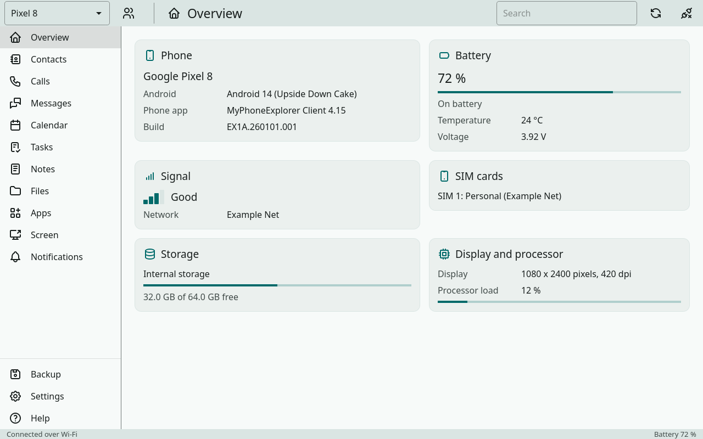
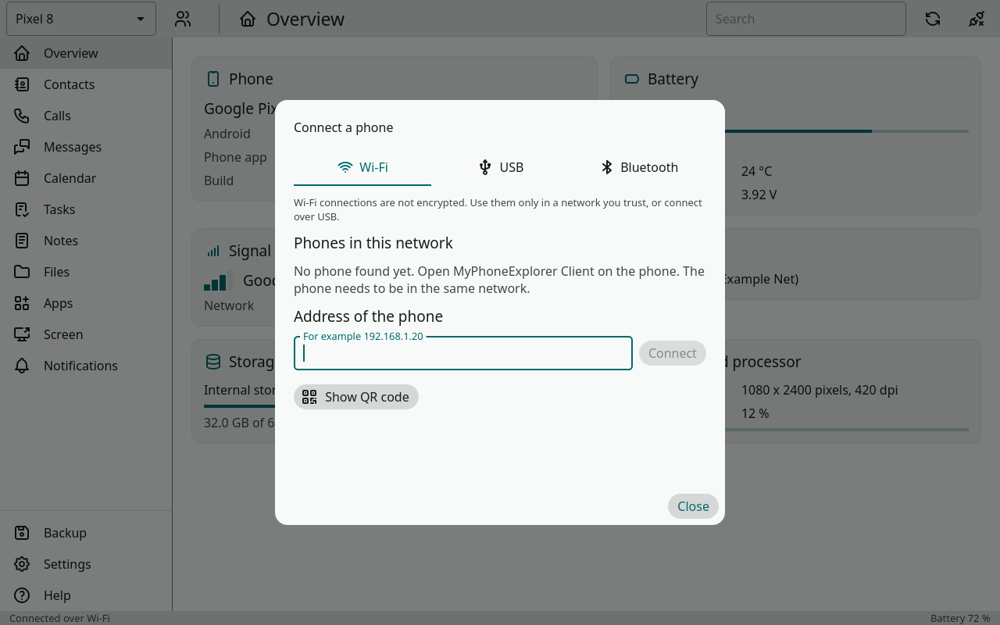
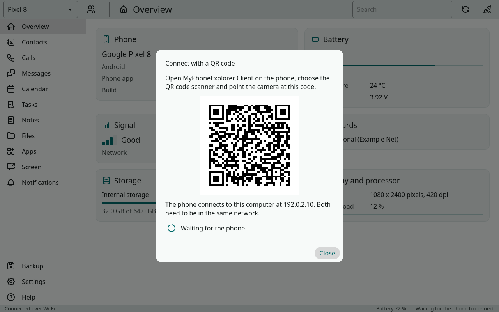
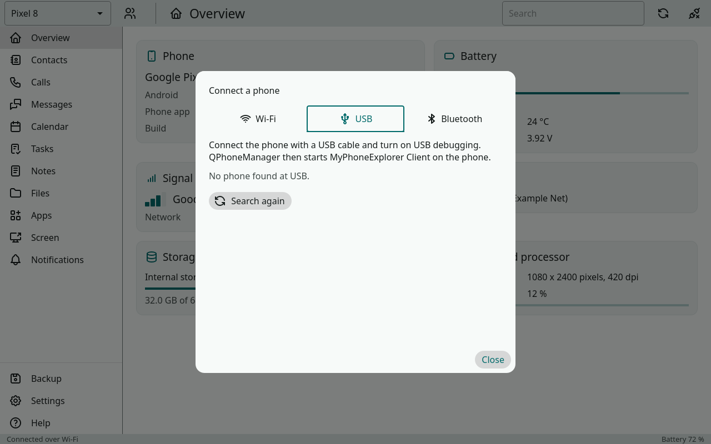
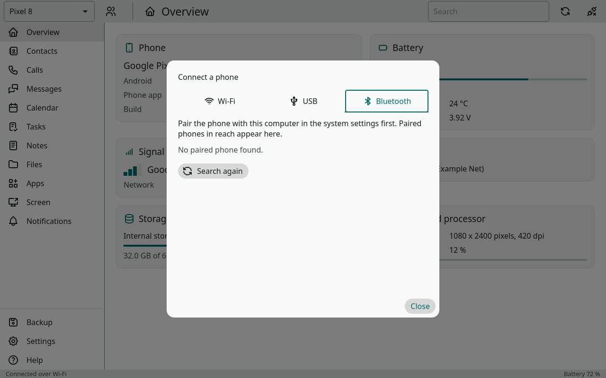
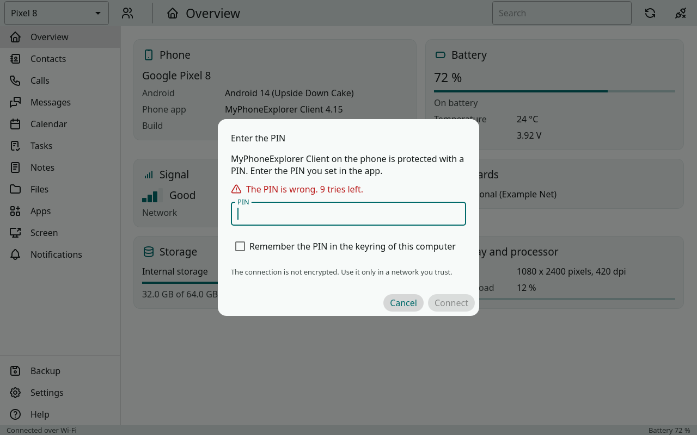

# Getting started

QPhoneManager connects your Android phone with this computer. You see and edit contacts, calls, messages, calendar, tasks and notes. You copy files, manage apps, mirror the phone screen and back up your data into a file.

On the phone, you need the app MyPhoneExplorer Client. QPhoneManager is an independent program and does not belong to the maker of that app.

## What you need

- On the phone: the app MyPhoneExplorer Client, version 4.15. QPhoneManager is made for this version. The app is available from Google Play.
- On the computer: Linux. For connections over USB you also need the program adb from the Android Platform Tools.
- For Bluetooth: the phone must be paired in the system settings of the computer.

How to build and start QPhoneManager is described in the file README.md in the source code of the program.

## The main window

- **Sidebar on the left:** It shows the areas of the program. At the bottom are **Backup**, **Settings** and **Help**. If the window is narrower than 1200 pixels, the sidebar shows only icons.
- **Header:** On the left you choose the phone. Next to it, **Manage phones** opens the list of all phones. On the right are the search field, **Sync** (two arrows in a circle) and **Connect** or **Disconnect** (a plug).
- **Content:** List and details sit side by side. If the content is narrower than 900 pixels, you see only one of the two. **Back** returns to the list.
- **Status line at the bottom:** It shows the connection, the battery level of the phone and running transfers.
- **Messages:** Results and errors appear in a bar above the content. The bar closes by itself after 15 seconds. It stays open while the mouse pointer rests on it or the keyboard focus is in it. **Close message** hides it at once.

The icons in the toolbars carry no text. Hold the mouse pointer over an icon to see its name.

The search field filters the list of the open area. It is active only where a list with data is there.

### Keyboard

| Key | Effect |
|---|---|
| Ctrl+1 to Ctrl+9 | Open the first nine areas of the sidebar |
| Ctrl+F | Move to the search field |
| F5 | Sync, when the phone is connected |
| Ctrl+N | Create a new entry, where the area offers it |
| Ctrl+, | Open the settings |
| F1 | Open the help for the open area |
| Ctrl+Q | Quit QPhoneManager |

## Connect a phone for the first time

Choose **Connect** at the top right. In an empty area the same button sits in the middle. The dialog **Connect a phone** opens, with the tabs **Wi-Fi**, **USB** and **Bluetooth**.

### Over Wi-Fi

The phone and the computer must be in the same network.

1. Open MyPhoneExplorer Client on the phone.
2. In QPhoneManager, choose **Connect** and the tab **Wi-Fi**. QPhoneManager starts looking for phones in the network.
3. Choose your phone under **Phones in this network**.

If QPhoneManager does not find the phone, enter the address yourself. MyPhoneExplorer Client shows it on the phone. Enter it under **Address of the phone**, for example 192.168.1.20, and choose **Connect**.

The third way is the QR code:

1. Choose **Show QR code**.
2. Open MyPhoneExplorer Client on the phone and choose the QR code scanner.
3. Point the camera at the code on the screen. The phone then connects to the computer by itself.

The code holds the address of this computer. As long as the window with the code is open, the computer waits for the phone. The status line then shows **Waiting for the phone to connect**. What the app reports to its maker while scanning is up to the app. QPhoneManager calls no services of the maker.

Wi-Fi connections are not encrypted. Use them only in a network you trust, or connect over USB.

### Over USB

1. Connect the phone to the computer with a USB cable.
2. On the phone, turn on USB debugging and allow the computer access.
3. In QPhoneManager, choose **Connect** and the tab **USB**.
4. Choose your phone under **Phones at USB**.

QPhoneManager starts MyPhoneExplorer Client on the phone itself. If the list is empty, choose **Search again**. If the program adb is missing, give its path in the settings under **Connection**.

### Over Bluetooth

1. Pair the phone with the computer in the system settings.
2. In QPhoneManager, choose **Connect** and the tab **Bluetooth**.
3. Choose your phone under **Paired phones**.

Over Bluetooth, file transfers, thumbnails, saving and installing apps and screen mirroring do not work. For these you need Wi-Fi or USB.

### The PIN

If a PIN protects the app on the phone, QPhoneManager asks for it. The app uses it to protect Wi-Fi connections.

1. In the dialog **Enter the PIN**, enter the PIN you set in the app.
2. If you like, tick **Remember the PIN in the keyring of this computer**. QPhoneManager then uses the stored PIN by itself at the next connection.
3. Choose **Connect**.

QPhoneManager reports a wrong PIN together with the number of tries left. After too many wrong PINs the app on the phone stops. Open it again, then connect once more.

If QPhoneManager cannot reach the keyring of the system, it does not store the PIN and asks every time. The PIN gives only weak protection. Prefer to connect over USB or in a network you trust.

## After connecting

The status line shows **Connected over Wi-Fi**, **USB** or **Bluetooth**. The **Overview** shows the state of the phone.

QPhoneManager loads contacts, calls, messages, calendar, tasks and notes only when you choose **Sync** or press F5. During the first sync of a phone, a window shows which area is loading. It closes when the sync ends. Afterwards, a bar reports for each area what is new, changed or deleted. Later syncs fetch only the changes for contacts, messages, calendar, tasks and notes. QPhoneManager reads the call log in full each time. Files, apps, notifications and the screen come live from the phone. They are not part of the sync.

Without a connection, QPhoneManager shows the data of the last sync. A note at the top gives the date. You can edit only while the connection is up.

At start, QPhoneManager connects to the phone you used last. It tries the ways in the order from the settings, and only those the phone has connected over before. After a dropped connection it reconnects by itself over Wi-Fi and USB. It does not do so over Bluetooth, nor when the phone connected by QR code. You can switch both off in the settings.

## When the connection does not work

Every message from QPhoneManager names the reason and the next step. The most common cases:

**No phone found (Wi-Fi)**

1. Open MyPhoneExplorer Client on the phone.
2. Check that the phone and the computer are in the same network.
3. Otherwise, enter the address of the phone by hand.

**The app does not allow Wi-Fi connections**

1. Allow Wi-Fi connections in the settings of MyPhoneExplorer Client on the phone.
2. Connect again, or use USB.

**The phone is connected to another computer**

1. End the other connection.
2. Connect again.

**No phone at USB**

1. Check the cable.
2. On the phone, turn on USB debugging, unlock the phone and allow the computer access.
3. Choose **Search again**.

**No connection over Bluetooth**

1. In the Android settings under Apps, allow MyPhoneExplorer Client the permission **Nearby devices**.
2. Turn on Bluetooth in the settings of MyPhoneExplorer Client.
3. Connect again.

If the phone was already connected to the computer over Bluetooth when you started the app, disconnect it once in the Bluetooth settings of the computer. The computer reads the services of the phone only once per connection.

**The app lacks a permission on the phone**

1. Open the Android settings of the phone and go to Apps.
2. Allow MyPhoneExplorer Client the missing permission. The message names the area, such as contacts, calendar, messages or files.
3. Repeat the action.

**The app is not installed**

1. Install MyPhoneExplorer Client from Google Play.
2. Connect again.

## Help and the About dialog

F1 opens the chapter for the area you are looking at. In the dialogs **Settings** and **Backup**, F1 closes the dialog and opens the matching chapter. **Help** at the bottom of the sidebar opens this chapter.

The help shows the table of contents on the left. **Back** and **Forward** take you through the chapters you have read. Tab jumps from link to link, and Enter follows a link. Links to the web open the browser if they start with https.

The help appears in the language of the program. If a chapter is missing in that language, it appears in English, then in German.

**About QPhoneManager** at the top right of the help shows the version, the license, the Qt version and the licenses of the components in use. The arrow keys choose a component.

## The areas of the program

- [Overview](overview.md)
- [Contacts](contacts.md)
- [Calls](calls.md)
- [Messages](messages.md)
- [Calendar](calendar.md)
- [Tasks](tasks.md)
- [Notes](notes.md)
- [Files](files.md)
- [Apps](apps.md)
- [Screen](screen.md)
- [Notifications](notifications.md)
- [Back up and restore](backup.md)
- [Settings](settings.md)
