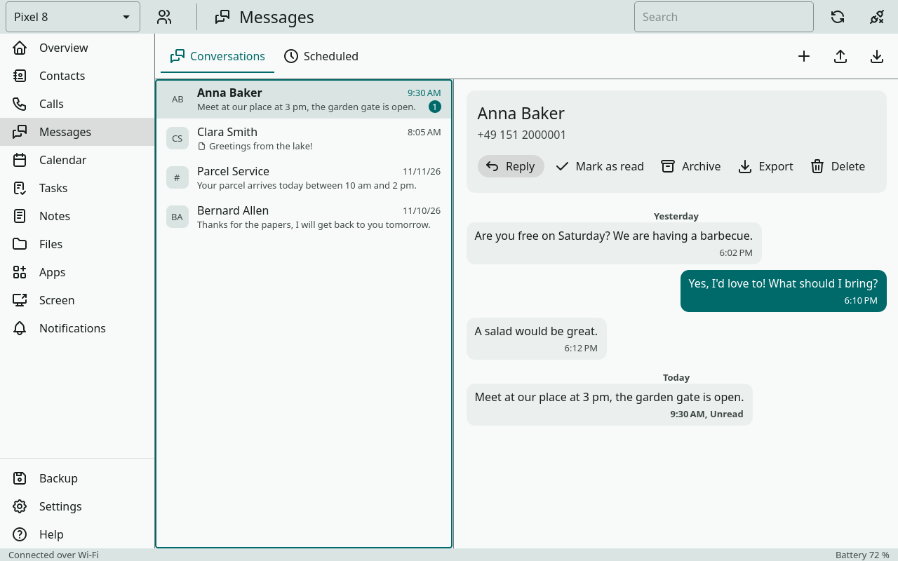
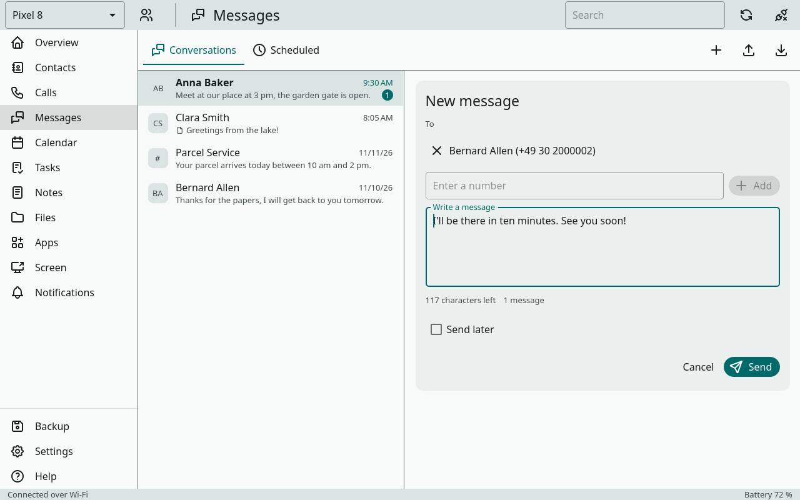

# Messages

Here you read text and multimedia messages as conversations and write new ones. You archive messages on this computer and schedule text messages that the phone sends later.

The messages appear after you have loaded them once with **Sync**. Without a connection you see the messages of the last sync.

## What you see

The tabs **Conversations** and **Scheduled** separate the conversation list from the scheduled messages. Next to the tabs are three icons:

| Icon | Name | Effect |
|---|---|---|
| Plus | **New message** | Opens the writing form |
| Arrow up | **Read an archive file** | Reads an archive file (.xml) into the archive on this computer |
| Arrow down | **Export all messages** | Writes all messages into a file |

The list shows one conversation per contact person, with the name from your contacts, the newest message first. A number on an entry gives the unread messages. On the right are the messages of the chosen conversation as speech bubbles. Your own messages are on the right, received ones on the left.

The search field in the header searches the texts of all messages and the names and numbers.

Pictures from MMS appear in the conversation. QPhoneManager shows other attachments with name and size. An attachment that stayed on the phone because it is large can be saved only there.

While the phone is connected, QPhoneManager reports a new message in the bar above the content. The conversation is loaded again.

## Write a message

Writing needs an open connection. QPhoneManager sends text messages through the phone. MMS cannot be sent.

1. Choose **New message** or press Ctrl+N. With **Reply** in a conversation, the recipient is already filled in.
2. Under **To**, enter a number and choose **Add**. You can add up to 20 recipients. The cross in front of a recipient removes it.
3. Write the text under **Write a message**. The counter shows how many characters still fit into the message and how many messages result. Special characters shorten a message.
4. If the phone has several SIM cards, choose the card under **SIM card**.
5. Choose **Send** or press Ctrl+Enter.

If the message did not go to all recipients, the message says to how many it went. If the phone does not confirm a text message, check in the list whether it was sent before you send it again.

## Schedule a message

The phone sends a scheduled text message at the chosen time on its own, even if this computer is off then.

1. Open the writing form as above.
2. Tick **Send later**.
3. Enter **Date** and **Time**. The time must be at least one minute ahead.
4. Choose **Schedule**.

The tab **Scheduled** lists all scheduled messages with the state **Waiting**, **Sent**, **Not sent** or **Sent to 1 of 2**. Choose a message to change it and save with **Save**, or delete it with **Delete**. **Plan a message** creates a new one.

## Archive

Archived messages stay on this computer, even if they are deleted on the phone.

- **Archive** puts all messages of the chosen conversation into the archive.
- A right click on a single message or the menu key opens a menu. **Keep in the archive** archives this message. **Take out of the archive** takes it out again. A message that exists only on this computer stays in the archive. Delete it if you no longer need it.
- **Read an archive file** adds messages from an archive file that you exported earlier. QPhoneManager takes in only messages that are not there yet.

## Export

1. Choose **Export** in the conversation or **Export all messages**.
2. In the file dialog, choose the format: table (.csv), web page (.html) or archive file (.xml).
3. Choose the place and name.

Only the archive file can be read back later.

## Save attachments

- The icon next to an attachment saves it. Its name is **Save file name**, with the name of the attachment. A file dialog asks for the place and name.
- In the menu of a message, **Save all attachments** saves all attachments of the message into a folder that you choose.

## Mark as read and delete

- QPhoneManager sends **Mark as read** and **Delete** to the phone as a request. MyPhoneExplorer Client 4.15 refuses both for text messages because it lacks the permission. The message then stays on the phone and in the list. QPhoneManager says so and advises you to archive the message on this computer.
- MMS can be neither deleted nor marked as read. QPhoneManager sends no request for them. Delete MMS on the phone itself.
- Before deleting, QPhoneManager asks. The question says that the phone deletes text messages only if its app allows it.
