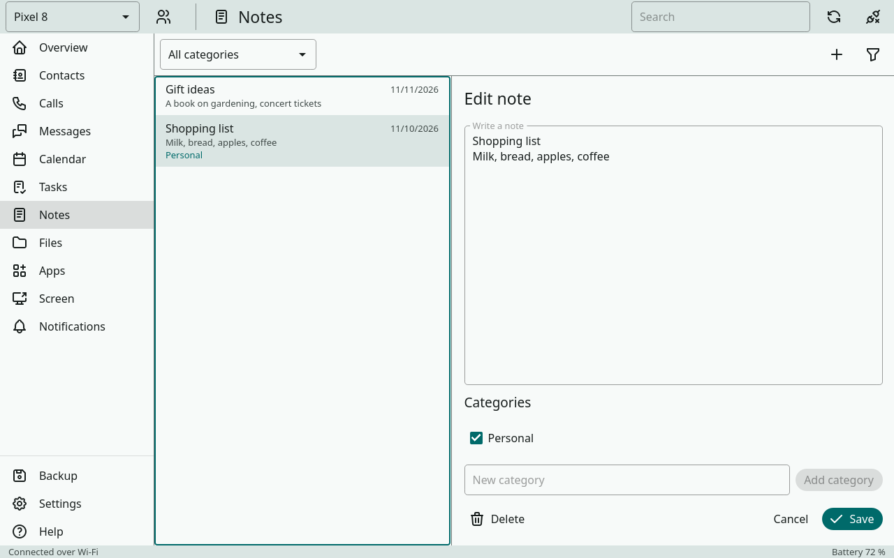

# Notes

Here you read, write and sort the notes of the phone.

The notes appear after you have loaded them once with **Sync**. Without a connection you see the state of the last sync.

## What you see

Each entry of the list shows the first line of the note as its title, the date, a preview of the following lines and the categories. An empty note is called **(Empty note)**.

Above the list, the field **All categories** is on the left. With it you show only the notes of one category. On the right are two icons:

| Icon | Name | Effect |
|---|---|---|
| Plus | **New note** | Creates a note |
| Funnel | **Note categories** | Opens the management of the categories |

The search field in the header searches the text and the categories.

## Write a note

1. Choose **New note** or press Ctrl+N. The form opens on the right.
2. Write the text under **Write a note**. The first line becomes the title.
3. Under **Categories**, tick boxes, or create one under **New category** and choose **Add category**.
4. Choose **Save**.

The note goes to the phone as soon as you save it and is there in the notes of MyPhoneExplorer Client. If a text is too large for the phone, shorten it.

## Change or delete a note

1. Choose the note in the list.
2. Change the text and choose **Save**, or choose **Delete**. In the list, Delete also works.
3. When deleting, confirm the question with **Delete**.

QPhoneManager deletes the note on the phone and on this computer.

If the note has changed on the phone since QPhoneManager loaded it, the dialog **The note was changed on the phone** opens. Choose **Save my version**, **Keep the phone's version** or **Back to editing**.

## Manage categories

1. Choose **Note categories**.
2. For a new category, enter a name under **Name**, choose a **Colour** and then **Add**.
3. For an existing category, choose it in the list. Then change the name or colour and choose **Change**, or choose **Delete**.

You can change categories only while the connection is up.
