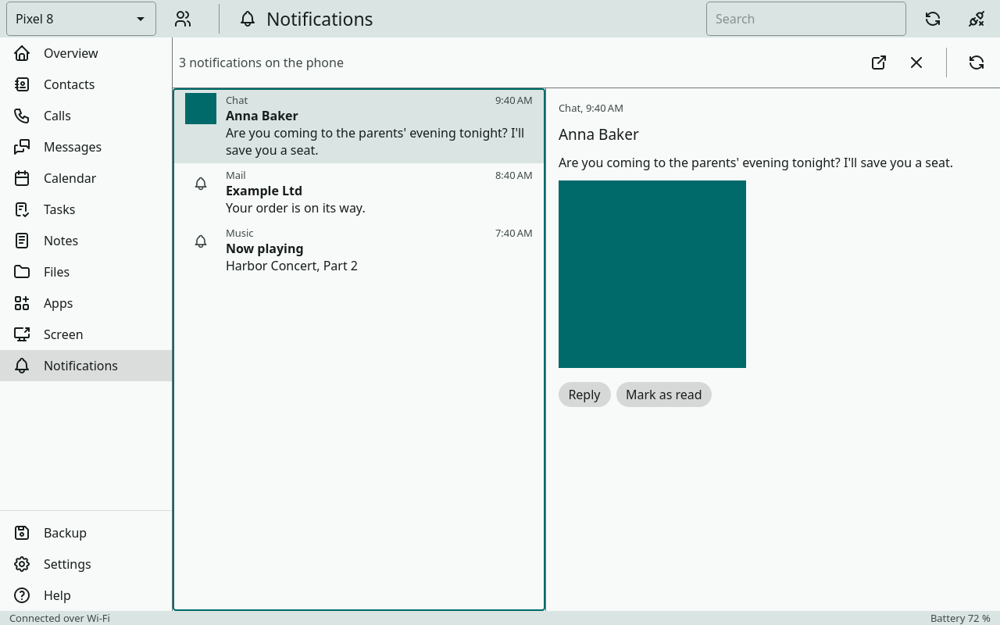

# Notifications

Here you see the notifications of the phone and dismiss them. This also covers the messages on the desktop, the sharing of the clipboard, the window for calls and the icon in the notification area.

The notifications come live from the phone. QPhoneManager reads the list anew at each connection. It is not part of the sync.

## What you see

Above the list it says how many notifications the phone shows. Each entry names the app, the time, the title and the text. On the right are the details of the chosen notification, with a picture if there is one, and the actions that the app offers, for example **Reply**.

At the top right of the list are three icons:

| Icon | Name | Effect |
|---|---|---|
| Arrow out of a frame | **Open on the phone** | Opens the notification on the phone |
| Cross | **Dismiss on the phone** | Dismisses the notification on the phone |
| Two arrows in a circle | **Load again** | Reads the list once more |

Enter opens the chosen notification on the phone, and Delete dismisses it there.

A button below the details runs an action of the notification on the phone. QPhoneManager then reports **Done on the phone.** The icon for dismissing is grey if a notification cannot be dismissed, for example because the phone shows it permanently. If the phone keeps a notification anyway, QPhoneManager asks you to close it on the phone.

## If the list stays empty

MyPhoneExplorer Client needs the notification access on the phone. If it is missing, the area shows a note.

1. Choose **Show the setting on the phone**. The phone opens the setting.
2. Allow MyPhoneExplorer Client the access there.
3. In QPhoneManager, choose **Load again**.

If QPhoneManager reports that the notification access is not running, switch it off and on again on the phone.

## Messages on the desktop

For each new notification of the phone, QPhoneManager shows a message on the desktop as long as the phone is connected. The message runs through the notification service of your desktop. It has these buttons:

- **Show:** Brings QPhoneManager to the front and opens this area.
- The actions of the notification, for example **Reply**.
- **Dismiss on the phone:** Missing for notifications that the phone shows permanently.

If you close only the message on the desktop, nothing changes on the phone.

You switch the messages on or off in the settings under **Notifications** with **Show new notifications of the phone on this computer**. The list in this area stays either way.

## Clipboard

In the settings under **Notifications**, **Share the clipboard between the phone and this computer** switches the sharing on. It is off by default.

- Text that you copy on the computer goes to the phone.
- Text that you copy on the phone arrives only while MyPhoneExplorer Client is open there. Android hands the clipboard only to the app in the foreground.

## Calls

For a call on the phone, QPhoneManager opens a small window that stays above the other windows. It shows the name from your contacts and the number. The number is sometimes missing, for example if the app on the phone may not read the call log.

| Button | Effect |
|---|---|
| **Answer** | Answers the incoming call |
| **Decline** | Declines the incoming call |
| **Hang up** | Ends the conversation |
| **Mute** | Switches the microphone of the phone off |
| **Speaker** | Switches the speaker of the phone on |

**Mute** and **Speaker** work while a conversation is going on. QPhoneManager only controls the call. You hold the conversation through the phone. If an action does not work, the message names the reason. Then use the phone itself. While QPhoneManager exchanges data with the phone, a call can go unnoticed.

## Icon in the notification area

If your desktop offers a notification area, QPhoneManager shows an icon there. A click on it shows the window. The menu of the icon offers:

- **Show window**
- **Write message:** Opens a new message.
- **Disconnect:** Ends the connection to the phone.
- **Quit:** Quits QPhoneManager.

If you close the main window, QPhoneManager quits. If it should start with only the icon, tick **Start in the notification area, without the window** in the settings under **Notifications**. This applies from the next start. If the desktop has no notification area, the window opens anyway.
