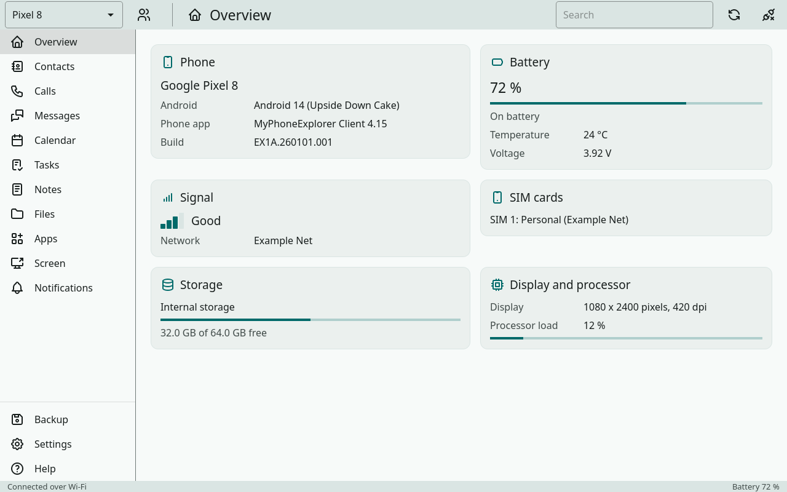

# Overview

The overview shows the model, battery, signal and storage of the connected phone. Here you also manage the phones that QPhoneManager knows.

## What you see

The overview is made of cards. A value that the phone does not report shows as **Not known**.

| Card | Content |
|---|---|
| **Phone** | Model, Android version, version of MyPhoneExplorer Client (**Phone app**) and the **Build** of the phone software |
| **Battery** | Charge level in percent, whether the phone is charging (**Charging**) or not (**On battery**), **Temperature** and **Voltage** |
| **Signal** | Signal strength from **No signal** to **Very good** and the **Network** of the provider |
| **SIM cards** | Each SIM card with its slot, name and provider |
| **Storage** | Free and total space in the **Internal storage** and on the **Memory card** |
| **Display and processor** | Resolution and density of the display and the **Processor load** |

Battery, signal and processor load update as long as the phone reports them. QPhoneManager asks for the storage again after an exchange of data with the phone, such as a file transfer.

If the card **SIM cards** says that the app may not read the SIM cards, allow MyPhoneExplorer Client the phone permission in the Android settings.

Without a connection, the page shows the state instead: **No phone connected**, **Connection lost** or **Waiting for the PIN**. The button **Connect** opens the dialog for connecting. How that works is described in [Getting started](getting-started.md).

## Several phones

QPhoneManager creates a profile for each phone as soon as it has connected once. It recognises the phone by the ID of the app. Each profile has its own name, its own data and, if you wish, its own stored PIN.

To see the data of a phone without a connection:

1. Open the field **Phone** on the left of the header.
2. Choose the phone.

QPhoneManager then shows the data of the last sync. You can read it, but not change it.

To rename or remove a phone:

1. Choose **Manage phones** in the header. The dialog **Phones on this computer** opens.
2. Choose **Rename**, enter 1 to 64 characters under **New name** and confirm with **Rename**.
3. Or choose **Remove** and confirm the question with **Remove**.

**Show** switches to another phone in the list. The phone that is shown now carries the note **shown now**.

**Remove** deletes the stored data and the remembered PIN of this phone from this computer. Nothing changes on the phone.
