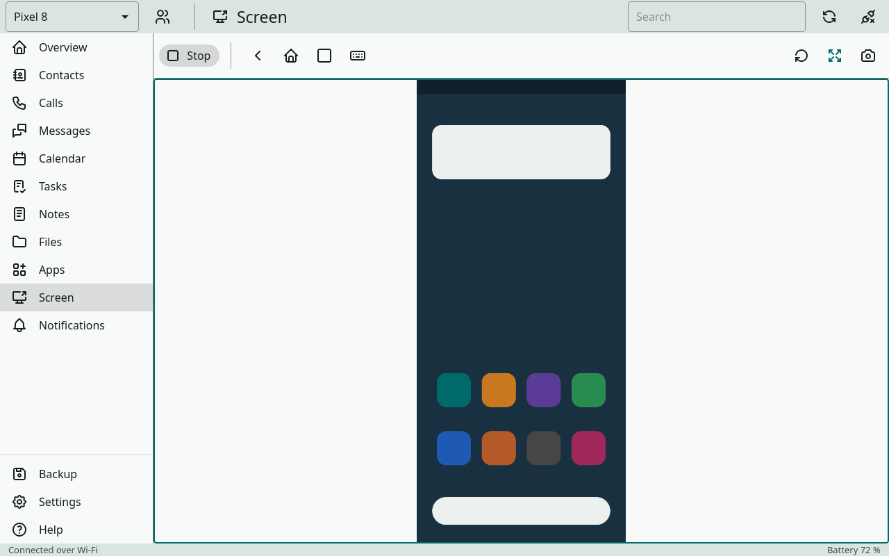

# Screen

Here you see the screen of the phone and control it with mouse and keyboard.

Mirroring works only over Wi-Fi or USB, not over Bluetooth. It needs Android 5 or newer on the phone. Controlling needs Android 7 or newer.

## Show the screen

1. Choose **Screen** in the sidebar.
2. Choose **Show the screen**. QPhoneManager asks the phone for its screen.
3. On the phone, confirm that it may share its screen. Choose the entire screen there.

The phone asks anew each time you start mirroring. If you do not confirm in time, mirroring stops. Start it again then.

The screen appears in the window and updates continuously. **Stop** ends mirroring. The computer shows everything that is on the screen of the phone, including messages and notifications.

## Control the phone

Controlling needs the accessibility service of MyPhoneExplorer Client on the phone. If it is off, QPhoneManager shows a note above the picture. To switch it on:

1. Choose **Open the setting on the phone**. The phone shows how to switch on the accessibility service.
2. Switch it on, on the phone.
3. In QPhoneManager, choose **Check again**.

After that:

- **Clicking** taps the spot.
- **Dragging** swipes.
- **Right-clicking** presses and holds.
- The **mouse wheel** scrolls.

The toolbar holds these icons:

| Icon | Name | Effect |
|---|---|---|
| Arrow left | **Back** | Presses the Back key of the phone |
| House | **Home screen** | Goes to the home screen |
| Square | **Recent apps** | Opens the overview of recent apps |
| Keyboard | **Type on the phone** | Sends text that you type to the phone |
| Arrow in a circle | **Turn the picture** | Turns the picture by 90 degrees |
| Four arrows | **Fit into the window** | Fits the picture. Switched off, the screen appears at its full size |
| Camera | **Save a screenshot** | Saves the current picture as a PNG file |

The first four icons are active only when controlling works. **Turn the picture**, **Fit into the window** and **Save a screenshot** work as soon as a picture is there.

### Enter text

1. Choose **Type on the phone**. The focus moves to the picture.
2. Type the text with the keyboard of the computer. It goes to the phone.
3. Press Tab to leave the picture.

## Save a screenshot

1. Choose **Save a screenshot**.
2. In the file dialog, choose the place and name. The file is a PNG picture.

## If it does not work

- **The phone does not share the screen:** Start again and allow it on the phone. Confirm faster if the message says nobody confirmed in time.
- **The phone takes no input:** Switch on the accessibility service as described above. On phones with Android 5 and 6 there is no input from here.
- **The picture breaks off:** Start mirroring again.
