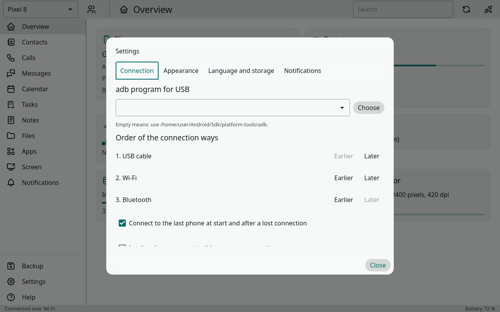
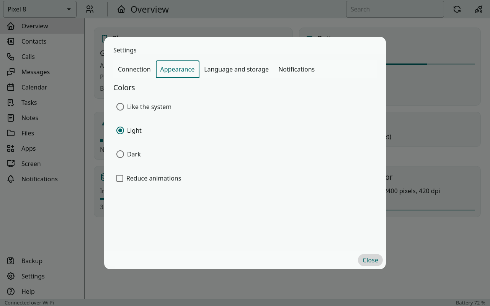
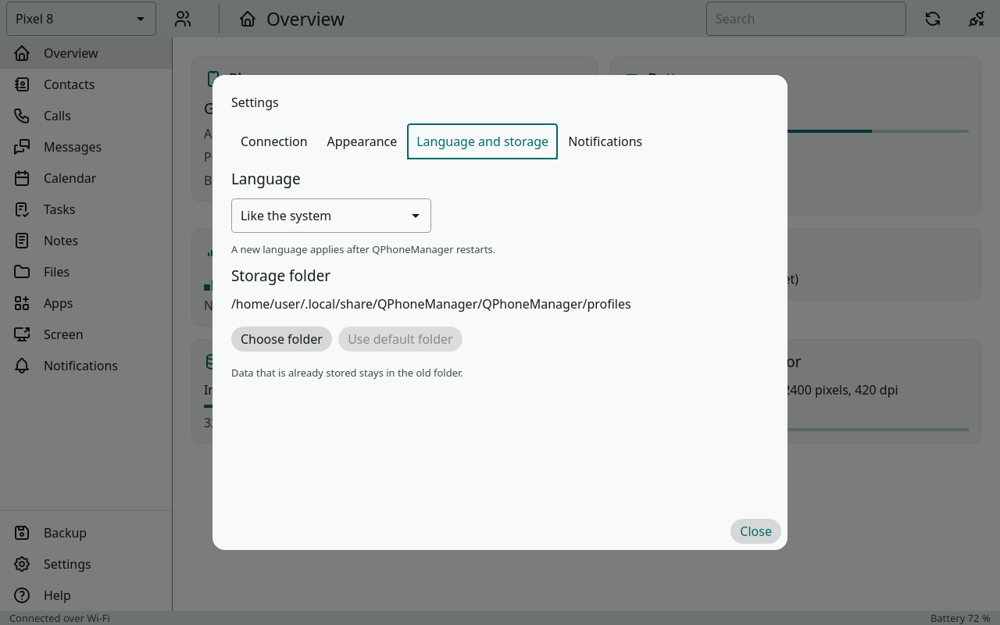
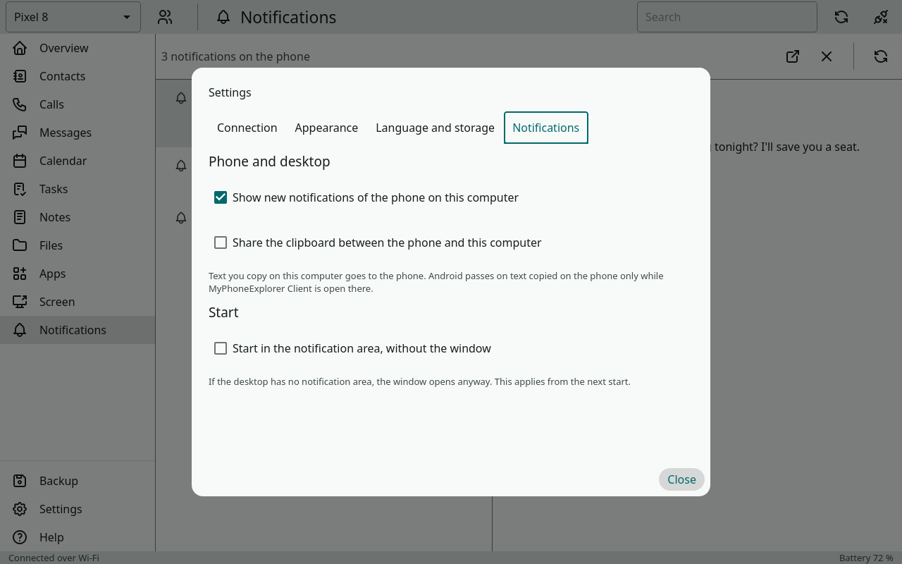

# Settings

Here you choose how the program connects, how it looks and where it stores data.

You open the dialog with **Settings** in the sidebar or with Ctrl+, (Ctrl and comma). It has four tabs. Each change applies at once, except where it says otherwise. **Close** ends the dialog. F1 closes it and opens this chapter.

## Connection

- **adb program for USB:** The program adb makes the connection over the USB cable. If you leave the field empty, QPhoneManager uses the adb that it finds itself. The note under the field gives the path. With **Choose** you pick another adb. If adb is missing on the computer, install the Android platform tools and choose adb here.
- **Order of the connection ways:** By default it is USB cable, Wi-Fi, Bluetooth. With **Earlier** and **Later** you move a way. At start, QPhoneManager tries the ways in this order, and only those the phone has connected over before.
- **Connect to the last phone at start and after a lost connection:** On by default. If it is off, you always connect by hand.
- **Let the phone connect to this computer at any time:** Off by default. Then the computer waits for the phone only while the window with the QR code is open. If it is on, the computer waits all the time. The status line then shows **Waiting for the phone to connect**. If another program uses the port that is needed for this, QPhoneManager says so.

Wi-Fi connections are not encrypted. Use them only in a network you trust, or connect over USB.

## Appearance

- **Colors:** **Like the system**, **Light** or **Dark**. By default QPhoneManager follows the system.
- **Reduce animations:** Dialogs, menus, drop-down lists, tool tips and the editing menu of text fields open and close without transitions. The marker of the tabs jumps to the chosen tab. Small animations of the style stay, for example for check marks, click effects and the fading of scroll bars. Off by default.

## Language and storage

- **Language:** **Like the system**, **Deutsch** or **English**. The field shows the chosen language. A new language applies after QPhoneManager restarts.
- **Storage folder:** Here QPhoneManager stores the data of your phones. The dialog shows the folder. By default it is the folder profiles under .local/share/QPhoneManager/QPhoneManager in your home directory. **Choose folder** picks another one. **Use default folder** goes back to the default.

Data that is already stored stays in the old folder. After a change, QPhoneManager shows only the phones whose data lies in the new folder. A folder that QPhoneManager cannot write to leads to a message.

## Notifications

- **Show new notifications of the phone on this computer:** On by default. It switches only the messages on the desktop. The list in the area [Notifications](notifications.md) stays.
- **Share the clipboard between the phone and this computer:** Off by default. Text that you copy on the computer goes to the phone. Text from the phone arrives only while MyPhoneExplorer Client is open there.
- **Start in the notification area, without the window:** Off by default. Without a notification area, the window opens anyway. This applies from the next start.

You choose the public holidays for the calendar in the area [Calendar](calendar.md), not here.
