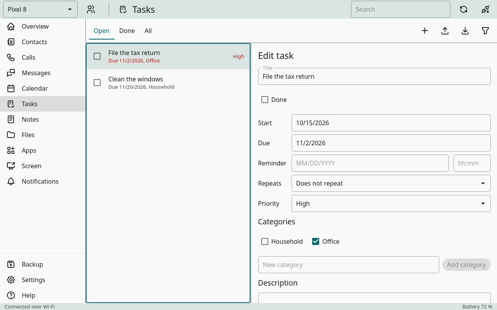

# Tasks

Here you manage the tasks of the phone and tick off the ones you have done.

The tasks appear after you have loaded them once with **Sync**. The sync fetches tasks and appointments together. Without a connection you see the state of the last sync.

## What you see

The tabs **Open**, **Done** and **All** filter the list. Each entry shows the title, with a box in front of it for ticking off, and below it the due date and the categories. QPhoneManager shows overdue tasks in red. A high priority appears in red at the edge.

To the right of the tabs are four icons:

| Icon | Name | Effect |
|---|---|---|
| Plus | **New task** | Creates a task |
| Arrow up | **Import tasks** | Reads an iCalendar file |
| Arrow down | **Export tasks** | Writes the tasks into an iCalendar file |
| Funnel | **Task categories** | Opens the management of the categories |

The search field in the header searches the title, description and categories.

## Create a task

1. Choose **New task** or press Ctrl+N. The form opens on the right.
2. Enter the **Title**.
3. If needed, enter **Start** and **Due**. You enter the date in the date format of your system. The start must not lie after the due date.
4. If needed, enter a **Reminder** with date and time. Enter both or neither.
5. If needed, choose **Repeats** and **Priority** (**High**, **Normal** or **Low**).
6. Under **Categories**, tick boxes, or create one under **New category** and choose **Add category**.
7. If needed, write a **Description**.
8. Choose **Save**.

A new task goes to the phone as soon as you save it.

## Tick off a task

Tick the box in front of the task, or choose the task and press the space bar. In the form, the field **Done** does the same. The tab **Done** shows finished tasks.

## Change or delete a task

1. Choose the task in the list.
2. Change the fields and choose **Save**, or choose **Delete**. In the list, Delete also works.
3. When deleting, confirm the question with **Delete**.

If the task has changed on the phone since QPhoneManager loaded it, the dialog **The task was changed on the phone** opens. Choose **Save my version**, **Keep the phone's version** or **Back to editing**.

## Manage categories

1. Choose **Task categories**.
2. For a new category, enter a name under **Name**, choose a **Colour** and then **Add**.
3. For an existing category, choose it in the list. Then change the name or colour and choose **Change**, or choose **Delete**.

You can change categories only while the connection is up.

## Import and export

- **Import tasks** reads files in the iCalendar format (.ics, .ical, .vcs). QPhoneManager leaves out tasks without a title and gives the number.
- **Export tasks** writes the tasks into an iCalendar file (.ics).
